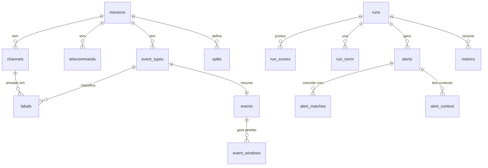

# Arquitetura do Banco de Dados — ESA-ADB (MCP + Autoencoder)

> **Status:** proposta de projeto (nada foi implementado ainda).
> **Escopo:** Mission1 (canais 41–46) e Mission2 (canais 18–28) do ESA-ADB.
> **Uso:** (1) servir as *tools* do servidor MCP de apoio à análise de dados; (2) servir de base de testes para o detector de anomalias baseado em **autoencoder**.

---

## Sumário

1. [Objetivo e como ler este documento](#1-objetivo-e-como-ler-este-documento)
2. [De onde partimos: o que a EDA nos ensinou](#2-de-onde-partimos-o-que-a-eda-nos-ensinou)
3. [Por que SQLite (e quando não usá-lo)](#3-por-que-sqlite-e-quando-não-usá-lo)
4. [Visão geral: os quatro arquivos de banco](#4-visão-geral-os-quatro-arquivos-de-banco)
5. [Convenções adotadas](#5-convenções-adotadas)
6. [Banco 1 — `esa_catalog.sqlite`](#6-banco-1--esa_catalogsqlite)
7. [Banco 2 — `esa_m1.sqlite` e `esa_m2.sqlite`](#7-banco-2--esa_m1sqlite-e-esa_m2sqlite)
8. [Banco 3 — `esa_experiments.sqlite`](#8-banco-3--esa_experimentssqlite)
9. [Como os bancos se conectam](#9-como-os-bancos-se-conectam)
10. [Pipeline de carga (ETL) e validações](#10-pipeline-de-carga-etl-e-validações)
11. [Uso pelo servidor MCP](#11-uso-pelo-servidor-mcp)
12. [Uso pelo autoencoder](#12-uso-pelo-autoencoder)
13. [Consultas de exemplo](#13-consultas-de-exemplo)
14. [Decisões de projeto e justificativas](#14-decisões-de-projeto-e-justificativas)
15. [Pontos em aberto e riscos](#15-pontos-em-aberto-e-riscos)
16. [Roteiro de implementação sugerido](#16-roteiro-de-implementação-sugerido)
17. [Glossário](#17-glossário)

---

## 1. Objetivo e como ler este documento

A pesquisa estuda como **avaliar a confiabilidade de alertas** em telemetria espacial: um alerta pode ser uma anomalia real, um evento nominal raro (uma operação planejada) ou ruído. Para isso precisamos de um lugar organizado onde os dados do ESA-ADB possam ser **consultados** (pelo MCP) e **usados** (pelo autoencoder), sem depender de abrir os arquivos `.zip`/`.csv` toda vez.

Este documento responde a três perguntas:

- **Quais bancos e tabelas vamos criar?** (seções 4 a 8)
- **Como os dados entram e como garantimos que estão corretos?** (seção 10)
- **Como o MCP e o autoencoder usam esses bancos sem interferir um no outro?** (seções 11 e 12)

Cada tabela é descrita com: *para que serve*, *de onde vem*, *colunas* e *regras*. Os blocos SQL são a **definição proposta**; ao implementar, eles devem ir para arquivos `.sql` versionados no repositório.

> 💡 **Leitura rápida:** se você só quer o desenho, leia as seções 4 e 9. Se vai implementar a carga, leia 5, 6, 7 e 10.

---

## 2. De onde partimos: o que a EDA nos ensinou

As decisões abaixo se baseiam no que as análises exploratórias mostraram. Os números da Mission2 são os da execução do notebook; os da Mission1 vêm do notebook correspondente.

| Fato observado | Consequência para o banco |
|---|---|
| Os canais do recorte têm **os mesmos timestamps** (Mission2: 7.387.262 leituras idênticas nos 11 canais). | Telemetria em **tabela larga** (uma linha por instante, uma coluna por canal), não em tabela longa. |
| Mission1 tem 6 canais locais (41–46) e Mission2 tem 11 (18–28). | Um **arquivo de telemetria por missão**, pois as colunas são diferentes. |
| Os IDs são **anonimizados por missão** (`channel_18` da Mission2 não é o `channel_18` da Mission1). | Toda chave inclui a **missão**: `(mission, id)`. |
| A cadência mediana é 18 s (Mission2) e 30 s (Mission1), com milissegundos nos timestamps. | Timestamps como **inteiros em milissegundos**. |
| Rótulos vêm em UTC; séries vêm sem fuso. A conversão foi repetida em todas as seções do notebook. | Converter **uma vez, na carga**, e guardar tudo em UTC. |
| `labels.csv` tem várias linhas por evento (5.274 linhas para 622 eventos na Mission2). | Guardar `labels` (intervalo por canal) **e** `events` (uma linha por evento, derivada). |
| Mission2: 19 anomalias e 603 eventos raros. Cortando a série ao meio, **18 das 19 anomalias caem no treino** e só 1 no teste. | A divisão treino/validação/teste precisa ser **explícita e guardada numa tabela** (`splits`). |
| Execuções de telecomando: 123 tipos na Mission2 (698 na Mission1); alguns têm ~90 mil execuções e outros 2. | Tabela longa e **indexada** para execuções de TC. |
| Quase toda janela (1 h, 6 h, 24 h) contém ao menos um TC; telecomandos periódicos aparecem em ~100% das janelas. | Guardar as **janelas de evento e de referência** (`event_windows`) para comparar eventos com referência. |
| A baseline robusta gerou 8.459 episódios, 96% sem anotação. | O banco de experimentos precisa ligar **alertas a eventos anotados** (`alert_matches`) e ao contexto de TC. |

---

## 3. Por que SQLite (e quando não usá-lo)

**Vantagens para este projeto**

- **Arquivo único, sem servidor:** simples de copiar, versionar (os pequenos) e usar no MCP.
- **SQL completo:** junções entre eventos, telecomandos e alertas são naturais.
- **Leitura concorrente segura:** vários leitores (MCP, notebooks) podem consultar o mesmo arquivo.
- **`ATTACH`:** permite consultar vários arquivos como se fossem um banco só.

**Limitações que devemos respeitar**

- **Um único escritor por vez.** Por isso o MCP lê e o pipeline de treino escreve em arquivos diferentes (seção 4).
- **Não é eficiente para treinar redes neurais** lendo linha a linha. A telemetria será consultada para **montar** conjuntos de treino em `.npy`/Parquet, e o treino lê esses arquivos (seção 12).
- **Chaves estrangeiras não funcionam entre arquivos `ATTACH`ados.** A consistência entre bancos é verificada **na carga** (seção 10).

> **Alternativa considerada:** guardar a telemetria em Parquet consultado com DuckDB. É mais compacta e rápida para análises pesadas, mas acrescenta uma dependência. Como o acesso é por janela de tempo com índice em `ts`, o SQLite atende; a decisão pode ser revista (seção 14).

---

## 4. Visão geral: os quatro arquivos de banco

```
data/db/
├── esa_catalog.sqlite       ← pequeno: metadados, rótulos, eventos, divisões, janelas
├── esa_m1.sqlite            ← pesado: telemetria + execuções de TC da Mission1
├── esa_m2.sqlite            ← pesado: telemetria + execuções de TC da Mission2
└── esa_experiments.sqlite   ← cresce: execuções do modelo, scores, alertas, métricas
```

| Arquivo | Conteúdo | Tamanho esperado¹ | Quem escreve | Quem lê |
|---|---|---|---|---|
| `esa_catalog.sqlite` | Missões, canais, telecomandos, tipos de evento, rótulos, eventos, divisões treino/teste, janelas | Pequeno (alguns MB) | Carga inicial | MCP, treino, notebooks |
| `esa_m1.sqlite` / `esa_m2.sqlite` | Telemetria (tabela larga) + execuções de telecomando | Da ordem de **1 GB** cada, dominado pela telemetria | Carga inicial (depois, só leitura) | MCP, treino |
| `esa_experiments.sqlite` | `runs`, scores, alertas, ligações com eventos, métricas | Cresce a cada experimento | Pipeline do autoencoder | MCP, análise |

¹ *Estimativas, ainda não medidas.* Telemetria Mission2: 7,39 M linhas × (8 B de `ts` + 11 canais × 8 B) ≈ 0,7 GB, mais overhead. Mission1: 15,38 M linhas × (8 B + 6 × 8 B) ≈ 0,9 GB. As execuções de telecomando (milhões de linhas) devem ser **medidas após a carga**.

### Por que quatro arquivos e não um?

| Motivo | Explicação |
|---|---|
| **Papéis diferentes** | Dados originais (imutáveis) × resultados de experimentos (mudam o tempo todo). |
| **Segurança do MCP** | O MCP abre os dados originais em **somente leitura**; nenhuma ferramenta consegue alterá-los. |
| **Escrita sem conflito** | O pipeline de treino escreve só em `esa_experiments.sqlite`, sem bloquear a leitura do MCP. |
| **Esquemas diferentes** | As colunas de telemetria diferem entre as missões. |
| **Versionamento** | O catálogo é pequeno e pode ser versionado ou regenerado rapidamente; a telemetria só é recarregada se os dados de origem mudarem. |

---

## 5. Convenções adotadas

### 5.1 Timestamps

- Guardados como **`INTEGER` em milissegundos desde 1970-01-01 (epoch), sempre em UTC**.
- Os arquivos de telemetria e telecomandos têm índice **sem fuso** (naive); são tratados como UTC.
- Os rótulos (`labels.csv`) vêm em UTC (sufixo `Z`) e são convertidos para o mesmo formato.
- Os valores originais em texto dos rótulos são **preservados** em `start_raw`/`end_raw` para auditoria.
- Conversão para leitura humana: `datetime(ts/1000, 'unixepoch')`.

> ⚠️ **Precisão:** os timestamps têm milissegundos. Se a carga encontrar precisão menor que 1 ms, isso deve ser registrado na validação (seção 10).

### 5.2 Chaves e identificadores

- Toda tabela de catálogo usa **chave composta com `mission`** (`'M1'` ou `'M2'`).
- Nomes originais são mantidos (`channel_18`, `telecommand_57`, `id_100`) para que resultados do banco e dos notebooks sejam comparáveis.
- Não presumimos que IDs de uma missão correspondam a IDs da outra.

### 5.3 Nomes

- Tabelas e colunas em **minúsculas, sem acento**, em português para colunas descritivas (`inicio_ts`, `n_canais`) e mantendo os nomes originais dos dados (`category`, `class`).
- Booleanos como `INTEGER` 0/1 com `CHECK`.

### 5.4 O que nunca é feito na carga

- **Não corrigir nem preencher** valores problemáticos silenciosamente (como no notebook: linhas inválidas são **sinalizadas**, não apagadas).
- **Não normalizar** as séries (normalização pertence ao experimento, e é ajustada só com dados de treino).
- **Não remover** zeros, valores extremos ou pausas. Zero é uma leitura registrada, não um erro por definição.

---

## 6. Banco 1 — `esa_catalog.sqlite`

Reúne tudo que é **pequeno, relacional e consultado com frequência**. Estrutura (resumo):

```
missions ─┬─ channels
          ├─ telecommands
          ├─ event_types ─┬─ labels ──(agregada em)──> events ─── event_windows
          │               └──────────────────────────────────────┘
          └─ splits
```

### 6.1 `missions`

**Para que serve:** descreve cada missão carregada e seu período de telemetria.
**Origem:** calculada na carga a partir das séries.

```sql
CREATE TABLE missions (
    mission             TEXT PRIMARY KEY,          -- 'M1' ou 'M2'
    nome                TEXT NOT NULL,             -- 'ESA-Mission1'
    inicio_ts           INTEGER NOT NULL,          -- primeira leitura (ms UTC)
    fim_ts              INTEGER NOT NULL,          -- última leitura (ms UTC)
    n_leituras          INTEGER NOT NULL,
    cadencia_mediana_s  REAL,                      -- p.ex. 18.0 (M2), 30.0 (M1)
    observacao          TEXT
);
```

### 6.2 `channels`

**Para que serve:** o "manual de bordo" dos sensores: subsistema, grupo e se é alvo da detecção.
**Origem:** `channels.csv`.

```sql
CREATE TABLE channels (
    mission        TEXT NOT NULL REFERENCES missions(mission),
    channel        TEXT NOT NULL,                  -- 'channel_18'
    subsystem      TEXT,
    physical_unit  TEXT,                           -- pode ser NULL (vários canais da M2 não têm)
    grp            INTEGER,                        -- 'Group' do CSV ('group' é palavra reservada)
    is_target      INTEGER NOT NULL CHECK (is_target IN (0,1)),   -- Target = YES → 1
    no_recorte     INTEGER NOT NULL DEFAULT 0 CHECK (no_recorte IN (0,1)),  -- 1 = canal com telemetria carregada
    PRIMARY KEY (mission, channel)
);
```

**Regras:** o catálogo completo é carregado (100 canais na M2, 76 na M1), mas só os canais do recorte têm `no_recorte = 1` e coluna em `telemetry`.

### 6.3 `telecommands`

**Para que serve:** catálogo dos tipos de telecomando e seu código `Priority`.
**Origem:** `telecommands.csv`.

```sql
CREATE TABLE telecommands (
    mission      TEXT NOT NULL REFERENCES missions(mission),
    telecommand  TEXT NOT NULL,                    -- 'telecommand_57'
    priority     INTEGER,                          -- usado como categoria, sem presumir criticidade
    PRIMARY KEY (mission, telecommand)
);
```

### 6.4 `event_types`

**Para que serve:** diz **o que foi** cada evento: anomalia, evento raro ou lacuna de comunicação.
**Origem:** `anomaly_types.csv`.

```sql
CREATE TABLE event_types (
    mission         TEXT NOT NULL REFERENCES missions(mission),
    event_id        TEXT NOT NULL,                 -- 'id_100'
    category        TEXT NOT NULL,                 -- 'Anomaly' | 'Rare Event' | 'Communication Gap'
    class           TEXT,
    subclass        TEXT,
    dimensionality  TEXT,                          -- calculada para a MISSÃO INTEIRA
    locality        TEXT,                          -- idem
    length          TEXT,                          -- idem
    PRIMARY KEY (mission, event_id)
);
```

> ⚠️ `dimensionality`, `locality` e `length` foram calculadas pelos autores considerando **todos os canais da missão**, não só o recorte. Devem ser tratadas como contexto, não como caracterização do recorte.

### 6.5 `labels`

**Para que serve:** o "gabarito" no nível mais fino: **um intervalo anotado por canal**.
**Origem:** `labels.csv`, com as datas convertidas para UTC.

```sql
CREATE TABLE labels (
    label_id         INTEGER PRIMARY KEY AUTOINCREMENT,
    mission          TEXT NOT NULL,
    event_id         TEXT NOT NULL,
    channel          TEXT NOT NULL,
    start_ts         INTEGER,                      -- NULL se a data original era ilegível
    end_ts           INTEGER,
    start_raw        TEXT,                         -- valor original do CSV
    end_raw          TEXT,
    valido           INTEGER NOT NULL CHECK (valido IN (0,1)),
    motivo_invalido  TEXT,                         -- 'data_ilegivel' | 'fim_antes_do_inicio' | 'id_ausente'
    FOREIGN KEY (mission, event_id) REFERENCES event_types(mission, event_id),
    FOREIGN KEY (mission, channel)  REFERENCES channels(mission, channel)
);
CREATE INDEX idx_labels_canal_tempo ON labels(mission, channel, start_ts, end_ts);
CREATE INDEX idx_labels_evento      ON labels(mission, event_id);
```

**Regras:**
- **Todas** as linhas do CSV entram (incluindo as de canais fora do recorte e as inválidas), com `valido` indicando se podem ser usadas. Nenhuma é apagada.
- Os dois critérios de invalidez são os mesmos do notebook: data ausente/ilegível, fim anterior ao início, ID ausente.
- Um mesmo evento pode ter **várias linhas por canal** (mais de um trecho). Não há unicidade em `(event_id, channel)`.

### 6.6 `events`

**Para que serve:** uma linha **por evento**, para contar, comparar categorias e definir janelas.
**Origem:** **derivada** de `labels` (válidas, canais do recorte) + `event_types`. Pode ser apagada e reconstruída a qualquer momento.

```sql
CREATE TABLE events (
    mission                 TEXT NOT NULL,
    event_id                TEXT NOT NULL,
    category                TEXT NOT NULL,
    class                   TEXT,
    start_ts                INTEGER NOT NULL,      -- primeiro início entre os canais do recorte
    end_ts                  INTEGER NOT NULL,      -- último fim
    n_canais                INTEGER NOT NULL,      -- canais distintos com rótulo
    n_intervalos            INTEGER NOT NULL,      -- linhas de labels
    PRIMARY KEY (mission, event_id),
    FOREIGN KEY (mission, event_id) REFERENCES event_types(mission, event_id)
);
CREATE INDEX idx_events_tempo ON events(mission, start_ts);
CREATE INDEX idx_events_cat   ON events(mission, category);
```

**Como interpretar:** `end_ts - start_ts` é o **envelope** dos rótulos (do primeiro início ao último fim), **não** necessariamente a duração contínua do fenômeno. Um evento com dois intervalos separados inclui o espaço entre eles (vimos até 19 h sem anotação dentro do envelope de um evento raro).

### 6.7 `splits`

**Para que serve:** define, de forma explícita e reprodutível, **quais períodos são treino, validação e teste**.
**Origem:** definida por você (a tabela nasce vazia ou com a divisão-padrão escolhida).

```sql
CREATE TABLE splits (
    mission     TEXT NOT NULL REFERENCES missions(mission),
    split_id    TEXT NOT NULL,                     -- p.ex. 'metade_m2', 'oficial', 'balanceado'
    papel       TEXT NOT NULL CHECK (papel IN ('train','val','test')),
    inicio_ts   INTEGER NOT NULL,
    fim_ts      INTEGER NOT NULL,                  -- intervalo [inicio_ts, fim_ts)
    descricao   TEXT,
    PRIMARY KEY (mission, split_id, papel, inicio_ts)
);
```

> **Por que é importante:** na Mission2, cortando ao meio (2001-09-30), 18 de 19 anomalias ficam no treino e o teste tem **uma**. Com a divisão em tabela, é possível guardar **várias** alternativas (a do ESA-ADB, se existir, e uma que deixe anomalias dos dois lados) e registrar em cada experimento qual foi usada.

### 6.8 `event_windows`

**Para que serve:** guarda as **janelas de tempo** anteriores a cada evento (1 h, 6 h, 24 h) e as **janelas de referência** sem rótulo correspondentes, usadas para comparar "antes de evento" × "dias normais".
**Origem:** derivada, com a lógica da seção 3.2 dos notebooks.

```sql
CREATE TABLE event_windows (
    mission     TEXT NOT NULL,
    event_id    TEXT NOT NULL,
    horas       INTEGER NOT NULL,                  -- 1, 6 ou 24
    tipo        TEXT NOT NULL CHECK (tipo IN ('evento','referencia')),
    inicio_ts   INTEGER NOT NULL,
    fim_ts      INTEGER NOT NULL,
    PRIMARY KEY (mission, event_id, horas, tipo),
    FOREIGN KEY (mission, event_id) REFERENCES events(mission, event_id)
);
```

**Regras:**
- `tipo = 'evento'`: a janela termina no início do evento (`fim_ts = events.start_ts`).
- `tipo = 'referencia'`: mesmo tamanho, algumas semanas antes, **sem cruzar nenhum rótulo, nenhuma janela de evento e nenhuma outra referência**.
- Quando não há referência disponível (ocorreu 293 vezes na Mission2, sobretudo em janelas de 24 h), **a linha simplesmente não existe**. Isso é conhecido e deve aparecer nas ferramentas do MCP como "referência indisponível".

---

## 7. Banco 2 — `esa_m1.sqlite` e `esa_m2.sqlite`

Cada arquivo tem a **mesma estrutura**, mudando apenas as colunas de canais. São a base **bruta e imutável**: depois da carga, só são abertos em leitura.

### 7.1 `telemetry`

**Para que serve:** as leituras dos sensores, uma linha por instante.
**Origem:** os `channels/channel_*.zip` (DataFrames *pickled*).

```sql
-- esa_m2.sqlite
CREATE TABLE telemetry (
    ts          INTEGER PRIMARY KEY,               -- ms UTC (vira o rowid: busca por janela muito rápida)
    channel_18  REAL, channel_19 REAL, channel_20 REAL, channel_21 REAL,
    channel_22  REAL, channel_23 REAL, channel_24 REAL, channel_25 REAL,
    channel_26  REAL, channel_27 REAL, channel_28 REAL
);
-- esa_m1.sqlite: colunas channel_41 ... channel_46
```

**Por que a tabela larga:**
- Os timestamps dos canais do recorte **coincidem exatamente** (verificado na Mission2). Uma linha por instante evita repetir o timestamp 11 vezes.
- É ~11× menos linhas que a forma longa (7,4 M em vez de ~81 M na Mission2).
- Facilita montar janelas multivariadas para o autoencoder (todas as colunas de um instante vêm juntas).

**Regras:**
- Se na carga os timestamps de algum canal **não** coincidirem com os demais, a carga **para e avisa**; não faz alinhamento automático.
- Valores ausentes ficam como `NULL` (não houve nenhum na Mission2). Zeros são mantidos.
- Se mais canais forem carregados depois, cria-se uma nova tabela ou se recria a larga; não se acrescentam colunas às cegas.

### 7.2 `tc_executions`

**Para que serve:** cada vez que um telecomando foi executado.
**Origem:** os `telecommands/telecommand_*.zip`.

```sql
CREATE TABLE tc_executions (
    telecommand  TEXT    NOT NULL,                 -- 'telecommand_57'
    ts           INTEGER NOT NULL,                 -- ms UTC
    PRIMARY KEY (telecommand, ts)
) WITHOUT ROWID;

CREATE INDEX idx_tc_ts ON tc_executions(ts, telecommand);
```

**Os dois índices respondem às duas perguntas centrais do projeto:**

| Pergunta | Índice usado |
|---|---|
| "Quando o `telecommand_57` foi executado?" | chave primária `(telecommand, ts)` |
| "Que telecomandos foram executados entre estes dois instantes?" | `idx_tc_ts (ts, telecommand)` |

**Regras:**
- O valor `1` do arquivo original (flag de execução) **não é guardado**: a existência da linha já significa "ocorreu".
- Execuções fora do período da telemetria são mantidas.
- Timestamps duplicados para o mesmo TC seriam rejeitados pela chave primária; a carga os **conta e reporta** antes de descartar.
- Não há coluna de missão porque o arquivo já é da missão. A ligação com o catálogo é por nome do telecomando.

### 7.3 `meta`

**Para que serve:** rastrear a origem e a versão da carga.

```sql
CREATE TABLE meta (
    chave  TEXT PRIMARY KEY,
    valor  TEXT
);
-- Ex.: ('mission','M2'), ('data_carga','2026-10-..'), ('hash_fonte', '...'),
--      ('n_leituras','7387262'), ('versao_esquema','1')
```

---

## 8. Banco 3 — `esa_experiments.sqlite`

É o **único banco que cresce**: guarda tudo que o autoencoder produz e permite que o MCP responda perguntas sobre os resultados. A pergunta central da pesquisa (*"em que o alerta do modelo coincide?"*) é respondida aqui.

```
runs ─┬─ run_norm
      ├─ run_scores
      ├─ alerts ─┬─ alert_matches
      │          └─ alert_context
      └─ metrics
```

### 8.1 `runs`

**Para que serve:** uma linha por experimento, com tudo o que é preciso para **reproduzi-lo**.

```sql
CREATE TABLE runs (
    run_id           INTEGER PRIMARY KEY AUTOINCREMENT,
    mission          TEXT NOT NULL,                -- 'M1' | 'M2'
    modelo           TEXT NOT NULL,                -- 'autoencoder_v1', 'baseline_mad', ...
    canais           TEXT NOT NULL,                -- lista JSON: ["channel_18", ...]
    split_id         TEXT NOT NULL,                -- referencia esa_catalog.splits
    janela_len       INTEGER NOT NULL,             -- nº de leituras por janela
    passo            INTEGER NOT NULL,             -- deslocamento entre janelas
    hiperparametros  TEXT,                         -- JSON: camadas, latente, épocas, lr, ...
    limiar_metodo    TEXT,                         -- 'p99_val', 'mad', ...
    limiar_valor     REAL,
    seed             INTEGER,
    commit_git       TEXT,                         -- versão do código que gerou o run
    criado_em        TEXT NOT NULL,                -- ISO 8601
    observacao       TEXT
);
```

> **Boa prática:** o `split_id` e o `commit_git` são obrigatórios na prática. Sem eles, não dá para saber depois por que dois runs deram resultados diferentes.

### 8.2 `run_norm`

**Para que serve:** guarda os parâmetros de normalização **ajustados só com dados de treino**, para poder reaplicá-los ao teste sem vazamento.

```sql
CREATE TABLE run_norm (
    run_id   INTEGER NOT NULL REFERENCES runs(run_id),
    channel  TEXT    NOT NULL,
    mediana  REAL    NOT NULL,
    escala   REAL    NOT NULL,                     -- p.ex. MAD × 1,4826 (com salvaguardas se MAD = 0)
    PRIMARY KEY (run_id, channel)
);
```

> Na Mission2, o `channel_18` tem escala robusta ≈ 0,00006 (sinal quase constante). Guardar a escala por canal deixa esse tipo de situação visível e auditável.

### 8.3 `run_scores`

**Para que serve:** o **score de anomalia por janela** (erro de reconstrução, no caso do autoencoder).

```sql
CREATE TABLE run_scores (
    run_id    INTEGER NOT NULL REFERENCES runs(run_id),
    ts_fim    INTEGER NOT NULL,                    -- instante da última leitura da janela (ms UTC)
    score     REAL    NOT NULL,
    PRIMARY KEY (run_id, ts_fim)
) WITHOUT ROWID;
```

**Por que por janela e não por leitura:** a baseline de uma só canal já avaliou 3,7 milhões de leituras só no teste. Guardar por janela (com `passo` > 1) reduz o volume, e o MCP pode devolver séries de scores já com limite de linhas.

### 8.4 `alerts`

**Para que serve:** **episódios de alerta**: janelas consecutivas acima do limiar, agrupadas por proximidade no tempo (a baseline usou tolerância de 30 min).

```sql
CREATE TABLE alerts (
    alert_id    INTEGER PRIMARY KEY AUTOINCREMENT,
    run_id      INTEGER NOT NULL REFERENCES runs(run_id),
    inicio_ts   INTEGER NOT NULL,
    fim_ts      INTEGER NOT NULL,
    pico_score  REAL    NOT NULL,
    n_janelas   INTEGER NOT NULL
);
CREATE INDEX idx_alerts_run_tempo ON alerts(run_id, inicio_ts);
```

### 8.5 `alert_matches`

**Para que serve:** liga cada alerta aos **eventos anotados** que ele sobrepõe — é aqui que se mede a confiabilidade do alerta.

```sql
CREATE TABLE alert_matches (
    alert_id         INTEGER NOT NULL REFERENCES alerts(alert_id),
    event_id         TEXT    NOT NULL,             -- referencia esa_catalog.events
    category         TEXT    NOT NULL,             -- copiada do catálogo para consulta rápida
    sobreposicao_s   REAL    NOT NULL,
    PRIMARY KEY (alert_id, event_id)
);
```

**Regra importante:** um alerta **sem** linhas em `alert_matches` é "alerta sem anotação conhecida". **Isso não significa falso positivo**: os rótulos podem ser incompletos. O MCP deve usar essa expressão, não "falso positivo".

### 8.6 `alert_context`

**Para que serve:** quais telecomandos aconteceram **perto de cada alerta**, para testar a hipótese central: *o contexto de TCs ajuda a distinguir anomalia de operação planejada?*

```sql
CREATE TABLE alert_context (
    alert_id        INTEGER NOT NULL REFERENCES alerts(alert_id),
    telecommand     TEXT    NOT NULL,
    n_exec_antes    INTEGER NOT NULL,              -- execuções na janela anterior ao alerta
    min_antes_s     REAL,                          -- tempo até a execução mais próxima
    janela_horas    INTEGER NOT NULL,
    PRIMARY KEY (alert_id, telecommand, janela_horas)
);
```

> Na EDA vimos que **quase toda janela contém algum TC**, então "há um TC antes?" não discrimina. Por isso o contexto é guardado **por tipo de telecomando e em contagem**, o que permite separar rotinas periódicas dos TCs específicos.

### 8.7 `metrics`

**Para que serve:** métricas calculadas por run, no geral e por categoria.

```sql
CREATE TABLE metrics (
    run_id    INTEGER NOT NULL REFERENCES runs(run_id),
    escopo    TEXT    NOT NULL,                    -- 'geral' | 'Anomaly' | 'Rare Event'
    metrica   TEXT    NOT NULL,                    -- 'recall_evento', 'n_alertas', 'pct_alertas_sem_anotacao', ...
    valor     REAL    NOT NULL,
    PRIMARY KEY (run_id, escopo, metrica)
);
```

> ⚠️ Métricas formais do benchmark ESA-ADB (e a divisão oficial de treino/teste) devem ser conferidas na documentação oficial antes de serem usadas como resultado final. A baseline da EDA é **exploratória**.

---

## 9. Como os bancos se conectam

### 9.1 Diagrama de relações



### 9.2 Ligações entre arquivos

| De | Para | Chave | Observação |
|---|---|---|---|
| `esa_m*.tc_executions.telecommand` | `esa_catalog.telecommands.telecommand` | nome (+ missão do arquivo) | Verificado na carga. |
| `esa_m*.telemetry` colunas | `esa_catalog.channels.channel` | nome da coluna | Idem. |
| `esa_experiments.runs.split_id` | `esa_catalog.splits.split_id` | `(mission, split_id)` | Idem. |
| `esa_experiments.alert_matches.event_id` | `esa_catalog.events.event_id` | `(mission, event_id)` | Idem. |

Como o SQLite **não impõe chaves estrangeiras entre arquivos**, a verificação é feita pelo script de carga e por uma rotina de "checagem de integridade" (seção 10.4).

### 9.3 Consultando vários arquivos de uma vez

```sql
ATTACH DATABASE 'file:data/db/esa_catalog.sqlite?mode=ro' AS cat;
ATTACH DATABASE 'file:data/db/esa_m2.sqlite?mode=ro'      AS m2;
ATTACH DATABASE 'file:data/db/esa_experiments.sqlite?mode=ro' AS exp;

-- Agora é possível cruzar tabelas de arquivos diferentes:
SELECT e.event_id, e.category, COUNT(*) AS n_tcs
FROM cat.events e
JOIN m2.tc_executions t
  ON t.ts >= e.start_ts - 6*3600*1000 AND t.ts < e.start_ts
WHERE e.mission = 'M2'
GROUP BY e.event_id;
```

> Para usar `file:...?mode=ro`, a conexão deve ser aberta com suporte a URI (em Python, `sqlite3.connect(..., uri=True)`).

---

## 10. Pipeline de carga (ETL) e validações

A carga deve ser um **script reproduzível** (por exemplo, `src/db/build.py`), executável do zero. Ele **recria** os arquivos a partir de `data/ESA/` e `data/ESA/*/` sem alterar os originais.

### 10.1 Ordem das etapas

| # | Etapa | Entrada | Saída |
|---|---|---|---|
| 1 | Criar esquemas vazios | arquivos `.sql` | bancos sem dados |
| 2 | Carregar catálogos | `channels.csv`, `telecommands.csv`, `anomaly_types.csv` | `channels`, `telecommands`, `event_types` |
| 3 | Carregar telemetria | `channels/channel_*.zip` | `telemetry` (em blocos, para não estourar memória) |
| 4 | Carregar telecomandos | `telecommands/telecommand_*.zip` | `tc_executions` |
| 5 | Carregar e auditar rótulos | `labels.csv` | `labels` (com `valido` e `motivo_invalido`) |
| 6 | Derivar eventos | `labels` + `event_types` | `events` |
| 7 | Derivar janelas | `events`, `labels` | `event_windows` |
| 8 | Registrar divisões | definição manual | `splits` |
| 9 | Gravar metadados | tudo acima | `meta`, `missions` |
| 10 | Checagem de integridade | todos os bancos | relatório de validação |

> **Memória:** a telemetria da Mission2 tem 7,4 M × 11 valores. A carga deve ler **um canal por vez** (ou em blocos de tempo) e gravar em transações grandes; depois criar os índices.

### 10.2 Validações da telemetria (as mesmas da EDA)

| Verificação | Como tratar |
|---|---|
| Índice é `DatetimeIndex` | Erro: parar. |
| Índice ordenado e sem duplicados | Erro: parar e investigar (não ordenar nem agregar sozinho). |
| Valores nulos, não numéricos ou infinitos | Reportar a contagem; manter como `NULL`. |
| Os canais têm os mesmos timestamps | Erro: parar (sem alinhamento automático). |
| Número de linhas inserido = número de linhas da fonte | Erro se diferir. |

Referência da Mission2: 7.387.262 leituras por canal, sem nulos, sem duplicados, índice ordenado.

### 10.3 Validações dos rótulos

| Verificação | Como tratar |
|---|---|
| `StartTime`/`EndTime` ilegíveis | `valido = 0`, `motivo_invalido = 'data_ilegivel'`; valor original em `start_raw`/`end_raw`. |
| Fim anterior ao início | `valido = 0`, `'fim_antes_do_inicio'`. |
| `ID` ausente | `valido = 0`, `'id_ausente'`. |
| IDs duplicados em `anomaly_types.csv` | Erro: parar. |
| ID de `labels` sem tipo em `anomaly_types` | Reportar (na Mission2: 0). |
| Um ID com mais de uma categoria | Erro (na Mission2: 0). |
| Rótulo fora do período da telemetria | Reportar por canal (na Mission2: 0). |

Referência da Mission2: 11.167 linhas de labels, 5.274 nos canais do recorte, 0 inválidas, 622 eventos (19 anomalias, 603 raros).

### 10.4 Checagem de integridade entre bancos

Após a carga, o script deve verificar e reportar:

- Todo `telecommand` de `tc_executions` existe em `telecommands`.
- Toda coluna de canal de `telemetry` existe em `channels` com `no_recorte = 1`.
- Todo `event_id` de `event_windows` existe em `events`.
- A soma de `events` por categoria bate com a contagem de `event_types` dos IDs do recorte.
- `PRAGMA foreign_key_check;` sem erros em cada arquivo.
- `PRAGMA integrity_check;` retorna `ok`.

### 10.5 Pós-carga

```sql
CREATE INDEX ...;       -- índices criados DEPOIS da inserção em massa (mais rápido)
ANALYZE;                -- estatísticas para o planejador de consultas
PRAGMA journal_mode=DELETE; -- bancos de dados originais: sem WAL, somente leitura
```

---

## 11. Uso pelo servidor MCP

O MCP expõe **ferramentas (tools)** que respondem perguntas sobre os dados sem que o modelo precise escrever SQL.

### 11.1 Princípios

1. **Somente leitura.** Os bancos são abertos com `mode=ro` e `PRAGMA query_only = ON`.
2. **Ferramentas com parâmetros, não SQL livre.** Todas as consultas são parametrizadas (nada é concatenado como texto).
3. **Limite de linhas e de tempo.** Toda resposta tem um máximo (por exemplo, 1.000 linhas) e um *timeout*. Janelas grandes de telemetria são **agregadas ou amostradas**, e a resposta informa isso.
4. **Avisos junto da resposta.** As respostas carregam as limitações dos dados (seção 11.3).
5. **Missão explícita.** Toda ferramenta recebe `mission`, para nunca misturar `channel_18` de missões diferentes.

### 11.2 Ferramentas sugeridas

| Ferramenta | Parâmetros | O que devolve | Banco(s) |
|---|---|---|---|
| `listar_missoes` | — | missões, período, cadência, canais carregados | catalog |
| `listar_canais` | `mission` | canais, subsistema, grupo, alvo | catalog |
| `resumo_eventos` | `mission`, `agrupar_por?` | contagem por categoria/ano/classe | catalog |
| `obter_evento` | `mission`, `event_id` | tipo, categoria, envelope, canais afetados, intervalos | catalog |
| `listar_eventos` | `mission`, `categoria?`, `inicio?`, `fim?`, `limite` | eventos filtrados | catalog |
| `telemetria_na_janela` | `mission`, `canais`, `inicio`, `fim`, `max_pontos` | série (amostrada se necessário) | m* |
| `estatisticas_do_canal` | `mission`, `canal`, `inicio?`, `fim?` | média, mediana, MAD, mín/máx, nº de pausas | m* |
| `tcs_na_janela` | `mission`, `inicio`, `fim`, `limite` | TCs executados e quantas vezes | m* + catalog |
| `tcs_antes_do_evento` | `mission`, `event_id`, `horas` | TCs na janela, com comparação à referência | m* + catalog |
| `tcs_mais_associados` | `mission`, `categoria`, `horas` | TCs por presença em eventos × referência | m* + catalog |
| `listar_runs` | `mission?` | experimentos com parâmetros e métricas | experiments |
| `alertas_do_run` | `run_id`, `limite` | alertas com pico e correspondência a eventos | experiments |
| `comparar_runs` | `run_a`, `run_b` | diferença de métricas | experiments |
| `explicar_alerta` | `alert_id` | evento coincidente, telemetria do entorno, TCs próximos | todos |

### 11.3 Avisos obrigatórios nas respostas

O MCP deve anexar o aviso aplicável:

- **Poucas anomalias:** "Mission2: 19 anomalias no recorte; percentuais variam 5,3 p.p. por anomalia."
- **Associação não é causa:** "A proximidade temporal entre telecomando e evento não demonstra causalidade."
- **Sem anotação ≠ normal:** "Ausência de rótulo não garante comportamento normal."
- **Referência indisponível:** quando a janela de referência não existir.
- **Datas anonimizadas:** "As datas não representam o calendário real da missão."
- **Dados amostrados:** quando a série devolvida foi reduzida.

---

## 12. Uso pelo autoencoder

### 12.1 Fluxo de um experimento

```
esa_catalog.splits ──┐
esa_m2.telemetry   ──┼─► montar janelas ─► arquivos .npy/Parquet ─► treinar ─► pontuar ─► alertas
esa_catalog.labels ──┘      (nominais)       (treino/val/teste)      (só treino)   (val/teste)    │
                                                                                                   ▼
                                                          esa_experiments (runs, scores, alerts, matches, metrics)
```

### 12.2 Passo a passo

1. **Escolher a divisão** em `splits` (`split_id`).
2. **Selecionar o treino nominal:** leituras do período de treino que **não** caem em nenhum intervalo de `labels` válido. (O autoencoder aprende o comportamento normal; treinar com eventos rotulados o ensinaria a reconstruí-los.)
3. **Montar janelas** de tamanho `janela_len` e `passo`, para os canais escolhidos, e **exportar** para `.npy` ou Parquet.
4. **Normalizar** com parâmetros calculados **só no treino** (mediana e escala robusta por canal) e gravar em `run_norm`.
5. **Treinar** o autoencoder lendo os arquivos exportados (não o SQLite).
6. **Pontuar** as janelas de validação e teste (erro de reconstrução) e gravar em `run_scores`.
7. **Definir o limiar** com dados de **validação** (nunca com o teste) e registrar em `runs`.
8. **Gerar alertas** agrupando janelas acima do limiar (`alerts`).
9. **Ligar alertas a eventos** (`alert_matches`) e ao contexto de telecomandos (`alert_context`).
10. **Calcular métricas** por categoria (`metrics`).

### 12.3 Cuidados contra vazamento de dados

| Risco | Prevenção |
|---|---|
| Treinar com eventos rotulados | Excluir janelas que cruzam `labels` do conjunto de treino. |
| Normalizar com o teste | Parâmetros só do treino (`run_norm`). |
| Ajustar o limiar no teste | Limiar definido na validação. |
| Janelas que cruzam a fronteira treino/teste | Janelas inteiras dentro de um único período. |
| Teste sem anomalias | Escolher um `split_id` com anomalias em validação e teste (na M2, o corte ao meio deixa 1 anomalia no teste). |

### 12.4 Por que o SQLite não é lido durante o treino

O treino percorre os dados várias vezes (épocas). Consultar o SQLite a cada lote seria lento e fragmentaria o acesso. A prática é:

- **Consultar o banco uma vez** para montar o conjunto (com `splits` e `labels`).
- **Salvar em arquivos** (`.npy`/Parquet) em `data/datasets/<run_id>/`.
- **Treinar a partir desses arquivos**, e gravar de volta apenas **resultados** (scores, alertas, métricas).

### 12.5 Reprodutibilidade

Um run deve poder ser repetido com: `mission`, `canais`, `split_id`, `janela_len`, `passo`, `hiperparametros`, `seed` e `commit_git`. Todos estão em `runs`.

---

## 13. Consultas de exemplo

**13.1 Eventos por categoria (Mission2)**

```sql
SELECT category, COUNT(*) AS eventos
FROM events
WHERE mission = 'M2'
GROUP BY category;
-- Esperado (referência da EDA): Rare Event 603, Anomaly 19
```

**13.2 Eventos por número de canais afetados**

```sql
SELECT category, n_canais, COUNT(*) AS eventos
FROM events
WHERE mission = 'M2'
GROUP BY category, n_canais
ORDER BY category, n_canais;
```

**13.3 Telemetria de um canal numa janela (com limite)**

```sql
SELECT ts, channel_18
FROM telemetry
WHERE ts BETWEEN :inicio AND :fim
ORDER BY ts
LIMIT 1000;
```

**13.4 Telecomandos executados nas 6 h antes de um evento**

```sql
SELECT t.telecommand, COUNT(*) AS execucoes
FROM cat.events e
JOIN m2.tc_executions t
  ON t.ts >= e.start_ts - 6*3600*1000 AND t.ts < e.start_ts
WHERE e.mission = 'M2' AND e.event_id = :evento
GROUP BY t.telecommand
ORDER BY execucoes DESC;
```

**13.5 Presença de um TC antes de eventos raros × anomalias**

```sql
SELECT e.category,
       COUNT(*)                                        AS eventos,
       SUM(EXISTS (SELECT 1 FROM m2.tc_executions t
                   WHERE t.telecommand = :tc
                     AND t.ts >= e.start_ts - 6*3600*1000
                     AND t.ts <  e.start_ts))          AS com_tc
FROM cat.events e
WHERE e.mission = 'M2' AND e.category IN ('Anomaly','Rare Event')
GROUP BY e.category;
```

> Para conclusões, compare sempre com as janelas de referência (`event_windows` com `tipo = 'referencia'`).

**13.6 Leituras de treino nominais (sem cruzar rótulos)**

```sql
SELECT t.ts, t.channel_18
FROM m2.telemetry t
JOIN cat.splits s
  ON s.mission = 'M2' AND s.split_id = :split AND s.papel = 'train'
 AND t.ts >= s.inicio_ts AND t.ts < s.fim_ts
WHERE NOT EXISTS (
    SELECT 1 FROM cat.labels l
    WHERE l.mission = 'M2' AND l.valido = 1
      AND t.ts BETWEEN l.start_ts AND l.end_ts
);
```

> Em volume grande, esta consulta é cara; na prática, a exclusão é feita em memória com intervalos unidos (como na função `unir_intervalos_ns` do notebook) e o resultado é exportado.

**13.7 De que são feitos os alertas de um run**

```sql
SELECT COALESCE(m.category, 'Sem anotação conhecida') AS contexto,
       COUNT(DISTINCT a.alert_id)                     AS alertas
FROM alerts a
LEFT JOIN alert_matches m ON m.alert_id = a.alert_id
WHERE a.run_id = :run
GROUP BY contexto;
```

> É a tabela análoga ao resultado da baseline (8.122 de 8.459 episódios sem anotação), agora para o autoencoder.

---

## 14. Decisões de projeto e justificativas

| # | Decisão | Alternativas | Por que esta |
|---|---|---|---|
| D1 | **SQLite** | PostgreSQL, DuckDB/Parquet | Arquivo único, sem servidor, leitura concorrente, suficiente para consultas por janela. Pode ser revisto para a telemetria. |
| D2 | **4 arquivos** (catálogo, 2 missões, experimentos) | 1 arquivo único | Separa dado original × resultado, evita conflito de escrita e mantém o MCP somente leitura. |
| D3 | **Telemetria em tabela larga** | Tabela longa (`ts, canal, valor`) | Timestamps coincidem; ~11× menos linhas e janelas multivariadas diretas. |
| D4 | **Timestamps em ms UTC (inteiro)** | Texto ISO | Comparação e índice rápidos; elimina a conversão de fuso repetida. |
| D5 | **Chave `(mission, id)`** | IDs globais | IDs são anonimizados por missão. |
| D6 | **Guardar `labels` e `events`** | Só `events` | `labels` preserva o intervalo por canal (necessário para o sincronismo entre canais e para recortar séries). |
| D7 | **`valido` + `motivo_invalido`**, sem apagar | Descartar linhas ruins | Mantém a rastreabilidade (o mesmo princípio da auditoria do notebook). |
| D8 | **`splits` em tabela** | Constantes no código | Torna a divisão explícita, reutilizável e registrada por experimento. |
| D9 | **Scores por janela** | Por leitura | Volume muito menor; suficiente para alertas por episódio. |
| D10 | **Treino fora do SQLite** (`.npy`/Parquet) | Ler do banco em cada época | Desempenho; o banco guarda a fonte da verdade e os resultados. |
| D11 | **Contexto de TC por tipo e contagem** | Só "há/não há TC" | A EDA mostrou que quase toda janela tem algum TC. |

---

## 15. Pontos em aberto e riscos

| Ponto | Situação | Ação sugerida |
|---|---|---|
| **Divisão treino/teste da Mission2** | O corte ao meio deixa 1 anomalia no teste (18 de 19 no treino). | Verificar se o ESA-ADB define uma divisão oficial; senão, definir uma que deixe anomalias nos dois lados e registrá-la em `splits`. |
| **Poucas anomalias** (19 na M2) | Métricas por categoria têm pouca força estatística. | Reportar contagens junto de cada métrica; considerar usar todos os canais. |
| **`events.csv` da Mission2** | 604 linhas (`event_N`), estrutura diferente de `labels.csv`. | Investigar a relação antes de decidir se entra no banco. |
| **Canal de referência** | O `channel_18` tem faixa normal muito estreita; limiares por MAD ficam sensíveis demais. | Avaliar o autoencoder em vários canais, não só no de referência. |
| **Mission1 só com canais 41–46** | O catálogo tem 76 canais; só 6 têm telemetria local. | `no_recorte` deixa isso explícito; se mais canais forem baixados, recarregar `telemetry`. |
| **Lacunas de comunicação** | Existem na Mission1 (4) e não na Mission2 (0). | Manter a categoria `Communication Gap` no esquema para a Mission1. |
| **Tamanho dos arquivos** | Estimativas (~1 GB por missão) não medidas. | Medir após a primeira carga; considerar Parquet/DuckDB se necessário. |
| **Chaves entre arquivos** | O SQLite não impõe integridade entre bancos. | Rotina de checagem (seção 10.4) a cada carga. |
| **Métricas oficiais** | A avaliação formal do benchmark deve seguir a documentação do ESA-ADB. | Conferir antes de reportar resultados finais. |
| **Itens do `MCP.md` e do plano de pesquisa** | Este documento não foi cruzado com esses arquivos. | Revisar as ferramentas e tabelas contra eles antes de implementar. |

---

## 16. Roteiro de implementação sugerido

| Fase | Entrega | Critério de pronto |
|---|---|---|
| **1. Esquemas** | Arquivos `.sql` de cada banco | Criam bancos vazios sem erro. |
| **2. Catálogo** | Carga de `channels`, `telecommands`, `event_types`, `labels`, `events` | Contagens batem com a EDA (M2: 622 eventos; 19 anomalias; 5.274 intervalos). |
| **3. Séries da Mission2** | `telemetry` + `tc_executions` | 7.387.262 linhas de telemetria; todos os TCs carregados; checagens da seção 10 sem erro. |
| **4. Séries da Mission1** | Idem | 15.381.169 linhas por canal (valor registrado no notebook da Mission1). |
| **5. Janelas e divisões** | `event_windows`, `splits` | Janelas reproduzem os números da seção 3.2 da EDA. |
| **6. MCP básico** | Ferramentas de leitura do catálogo e das séries | Respostas limitadas, parametrizadas e com avisos. |
| **7. Experimentos** | `esa_experiments.sqlite` + gravação do pipeline | Um run da baseline MAD gravado e consultável. |
| **8. Autoencoder** | Treino, scores, alertas e métricas gravados | Resultados reproduzíveis a partir de `runs`. |

> **Boa prática:** testar o script de carga primeiro com **dados sintéticos** no mesmo formato dos arquivos do ESA-ADB, e só depois com os dados reais.

---

## 17. Glossário

| Termo | Significado |
|---|---|
| **Telemetria** | Séries temporais de medidas dos sensores do satélite. |
| **Canal** | Um sensor/série de telemetria (`channel_18`). |
| **Telecomando (TC)** | Comando enviado ao satélite. Cada tipo tem um arquivo com os instantes de execução. |
| **Anomalia** (`Anomaly`) | Comportamento incomum e **indesejado**. |
| **Evento nominal raro** (`Rare Event`) | Comportamento incomum, mas **esperado** (operação, manobra, calibração). |
| **Lacuna de comunicação** (`Communication Gap`) | Período sem dados. |
| **Rótulo** (*label*) | Intervalo anotado por especialistas: início, fim, canal, ID do evento. |
| **Evento** | Um ID de evento, que pode ter vários rótulos (canais/trechos). |
| **Envelope** | Intervalo entre o primeiro início e o último fim dos rótulos de um evento. |
| **Janela de evento** | Período de N horas **antes** do início de um evento. |
| **Janela de referência** | Período do mesmo tamanho, sem rótulos, usado para comparação. |
| **Janela (autoencoder)** | Trecho de `janela_len` leituras consecutivas usado como entrada do modelo. |
| **Passo** | Deslocamento entre janelas consecutivas. |
| **Score** | Pontuação de anomalia (no autoencoder, o erro de reconstrução). |
| **Limiar** | Valor de score acima do qual a janela vira alerta. |
| **Alerta / episódio** | Conjunto de janelas acima do limiar, agrupadas por proximidade no tempo. |
| **Alerta sem anotação conhecida** | Alerta que não coincide com nenhum rótulo. **Não** é, por definição, falso positivo. |
| **MAD** | Desvio absoluto mediano; estimativa robusta de dispersão (× 1,4826 ≈ desvio padrão). |
| **Vazamento de dados** | Uso indevido de informação de teste (ou de eventos) no treino ou na calibração. |
| **WAL** | Modo de registro do SQLite que permite leitura durante a escrita; usado em `esa_experiments`. |
| **ETL** | Extração, transformação e carga dos dados para o banco. |
| **MCP** | Servidor que expõe ferramentas ao modelo de linguagem. |
