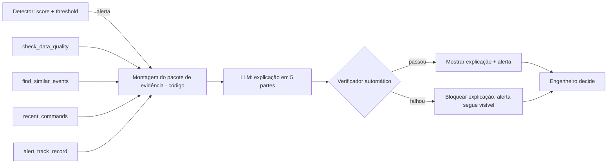

# Camada de interpretação de alertas - como explicar um alerta de anomalia em linguagem simples, e como testar se a explicação é confiável
IC Geração de Marte · outubro de 2026** **Linha de pesquisa:** Estatística, Ciência de Dados e Inteligência Artificial **Depende de:** Checkpoint 3 (Dia 21) do plano principal concluído.

> **Como ler este documento.** Ele é um complemento do plano principal ("Quando podemos confiar em um alerta de anomalia?") e segue a mesma lógica: escrito para quem **não** é da área espacial, com cada conceito novo explicado antes de ser usado. Estrutura: 1 (o módulo em 1 minuto), 2 (glossário), 3 (contexto e relevância), 4 (pergunta, hipótese e objetivos), 5 (arquitetura e tools), 6 (dados: Zenodo ou Kaggle), 7 (como avaliar), 8 (QA do módulo), 9 (cronograma), 10 (riscos), 11 (entregáveis), 12 (referências).

---

## 1. O módulo em 1 minuto

### O problema que sobra depois do detector

O plano principal constrói um detector de anomalias e mede **quando seus alertas merecem confiança**. Mas um alerta, sozinho, é só um aviso: "algo está estranho em tal momento". Quem recebe o aviso ainda precisa responder:

- O que exatamente está estranho?
- Isso já aconteceu antes? Era problema ou era normal?
- O dado que gerou o alerta é confiável?
- O que devo verificar primeiro?

Hoje, quem responde isso é um **engenheiro de operações**. É um trabalho caro, e o artigo do ESA-ADB lembra que um algoritmo que não indica onde está o problema tem pouca utilidade prática e aumenta a desconfiança dos operadores em sistemas "caixa-preta".

### A ideia

Uma **camada de interpretação**: um modelo de linguagem (LLM) que recebe as **evidências** que o detector e o código já calcularam e as **traduz para linguagem simples**, para que qualquer pessoa consiga entender o que está acontecendo.

### Três regras que não mudam

1. **O detector decide se há alerta. A LLM só explica.** Ela nunca cria, apaga nem rebaixa um alerta.
2. **Os números vêm de código, não do modelo.** A LLM recebe um "pacote de evidência" pronto e não calcula nada.
3. **Toda explicação passa por um verificador automático antes de ser mostrada.** Se violar uma regra, é bloqueada, e o alerta continua visível.

### Por que isso é uma pesquisa de qualidade, e não só uma funcionalidade

Uma explicação escrita por LLM é um **componente novo** e ele também pode errar, de forma convincente. A pergunta do módulo é a mesma do plano principal, aplicada a ele: **quando podemos confiar na explicação de um alerta?** O resultado esperado não é "a LLM é boa", e sim **um conjunto de testes e medidas que mostram onde ela acerta, onde erra e como o erro é barrado**.

**Em uma frase:** o detector aponta, o código reúne as provas, a LLM traduz, o verificador confere e o engenheiro decide.

---

## 2. Glossário (termos novos deste módulo)

|Termo|Explicação simples|
|---|---|
|**LLM**|Modelo de linguagem: programa que gera texto a partir de um texto de entrada. Fluente, mas pode escrever coisas falsas com segurança.|
|**Alucinação**|Quando o modelo afirma algo que não está nos dados (ex.: citar um sensor que não existe).|
|**Tool (ferramenta)**|Uma função que o modelo pode chamar para buscar informação (ex.: "buscar eventos parecidos"). Faz o cálculo; o modelo só pede e lê o resultado.|
|**MCP**|_Model Context Protocol_. Um padrão para oferecer tools a um modelo. É o "encanamento": define como as funções são expostas, não o que elas fazem.|
|**Resource / prompt (no MCP)**|Material fixo oferecido ao modelo (ex.: glossário, roteiro da explicação), diferente de uma tool, que executa algo.|
|**Pacote de evidência**|Conjunto de fatos sobre um alerta (score, canais, telecomandos recentes, histórico), montado por código e entregue ao modelo.|
|**Guardrail / verificador**|Regras automáticas que checam a resposta do modelo antes de ela aparecer (ex.: "só pode citar canais que estão na evidência").|
|**Replay**|Rodar o sistema sobre dados antigos, com rótulos conhecidos, como se estivessem chegando agora. Permite avaliar sem esperar eventos reais.|
|**Histórico de acerto (_track record_)**|Entre alertas parecidos no passado, quantos eram reais. Sempre com o tamanho da amostra.|
|**Vazamento (_leakage_)**|Usar no teste informação que só existiria no futuro. Invalida a avaliação.|
|**Consistência**|Dar a mesma resposta para a mesma entrada, repetida várias vezes.|

Os termos do plano principal (telemetria, anomalia, falha, evento raro normal, FP, FN etc.) continuam valendo.

---

## 3. Contexto e relevância

### 3.1. O gargalo humano

Interpretar um alerta de telemetria exige conhecimento da missão, do histórico e da operação. O ESA-ADB foi construído em cooperação entre engenheiros de operações e especialistas de ML justamente porque os relatos de anomalia existentes são escritos para humanos e não servem bem para ML. O artigo também apresenta o **alto índice de falsos alarmes como o principal obstáculo** à adoção de detecção automática, e aponta que alertas sem indicação de canais ou subsistemas afetados são pouco úteis.

### 3.2. O problema específico dos eventos raros normais

Na Mission2 do ESA-ADB há **613 eventos nominais raros** (manobras, resets, calibrações: incomuns, mas esperados) contra **31 anomalias**. O artigo relata que nenhum algoritmo avaliado distingue os dois e que nenhum identificou bem as 9 anomalias reais naquele cenário. Um detector alarma os dois; **quem separa é o contexto** (houve um telecomando antes? já aconteceu isso e era normal?). Esse é o ponto onde uma camada de interpretação, bem verificada, poderia ajudar.

Há também um relato de um trabalho que usa o desafio do Kaggle: a competição não diferencia anomalias verdadeiras de eventos nominais raros, tratando a tarefa como detecção geral de _outliers_. Isso reforça que **essa distinção é um problema aberto**.

### 3.3. Onde este módulo se encaixa no projeto

|Plano principal|Este módulo|
|---|---|
|Detector + threshold + métricas por evento (P2, P3)|Recebe os alertas gerados por eles|
|Análise de erros e eventos raros (P4)|Usa o histórico de eventos parecidos como contexto|
|Contraste de prevalência (P5)|Alimenta o histórico de acerto com contagens realistas|
|Evidências para autonomia e confiança (P6)|Fornece um estudo de caso: **explicação verificável como evidência de confiança**|

### 3.4. O que este módulo NÃO é

|Vamos fazer|Não vamos fazer|
|---|---|
|Explicar alertas **já gerados** pelo detector|Deixar a LLM detectar anomalias|
|Replay offline sobre o conjunto de teste|Operação em tempo real (streaming)|
|Verificador automático e métricas de qualidade da explicação|Provar que a LLM é "melhor" que um engenheiro|
|Teste de legibilidade com poucas pessoas|Validação com engenheiros de operação reais|
|Tools somente de leitura|Qualquer tool que envie comando à nave|
|Interface mínima de demonstração|Dashboard sofisticado|
|Comparar **versões do componente** (com e sem verificador)|Comparar vários modelos de LLM para eleger o melhor|

> **Explicação ≠ diagnóstico.** A camada diz "comportamento anômalo, sem causa operacional na evidência". Nunca "o componente X está falhando".

### 3.5. Limitação conhecida: dados anonimizados

O ESA-ADB é anonimizado (sem nomes de canais nem datas). A explicação **não pode dizer** "a temperatura do painel", só "o medidor CH_12". A linguagem simples fica limitada ao que os dados permitem. Para a demonstração visual pode-se usar nomes fictícios, **claramente marcados como fictícios**.

---

## 4. Pergunta, hipótese e objetivos

### 4.1. Pergunta direcionadora

**Versão curta:**

> **Quando podemos confiar na explicação que uma LLM dá a um alerta de anomalia?**

**Versão completa:**

> **Que regras de verificação e que evidências de entrada permitem que uma LLM explique alertas de anomalia em telemetria espacial, em linguagem simples, sem afirmar o que os dados não sustentam, e como medir a confiabilidade dessa explicação?**

### 4.2. Perguntas secundárias

|Código|Pergunta|Fica respondida quando...|
|---|---|---|
|**M1**|Com que frequência as explicações violam as regras de verificação, e quais regras são mais violadas?|Tabela de violações por regra, no replay.|
|**M2**|A explicação cita os canais certos?|Precision e recall dos canais citados contra o `labels.csv`, para alertas verdadeiros.|
|**M3**|A explicação distingue evento nominal raro de anomalia?|Matriz de confusão, com o erro perigoso (anomalia tratada como nominal) reportado à parte.|
|**M4**|Dar mais contexto (histórico, telecomandos, qualidade dos dados) melhora a explicação?|Comparação das métricas M1 a M3 entre pacotes de evidência com e sem cada item.|
|**M5**|A explicação é estável e compreensível?|Consistência em execuções repetidas + teste de legibilidade com leigos.|
|**M6**|O histórico de acerto de alertas parecidos prevê a confiabilidade de um alerta?|Taxa de acerto por faixa de histórico, com tamanho de amostra.|

### 4.3. Hipótese de trabalho

> Uma explicação gerada a partir de um pacote de evidência estruturado, e barrada por um verificador, comete menos afirmações sem respaldo do que uma explicação sem esses controles; e o contexto (histórico e telecomandos) melhora a distinção entre evento raro normal e anomalia.

Não é preciso "provar" a hipótese. Ela é a bússola. Um resultado como "o verificador barrou X% das respostas e o erro mais comum foi Y" já é uma contribuição.

### 4.4. Objetivo geral

Projetar e avaliar uma camada de interpretação que explica alertas de anomalia em linguagem simples, com verificação automática, e medir a confiabilidade dessas explicações em replay sobre telemetria espacial real.

### 4.5. Objetivos específicos

1. Definir o **pacote de evidência** e o **formato da explicação** (roteiro de 5 partes).
2. Implementar as tools como **funções puras e testáveis**, com um invólucro MCP fino por cima.
3. Implementar o **verificador** de respostas (regras da seção 5.5).
4. Rodar o **replay** no conjunto de teste e medir M1 a M6.
5. Aplicar testes de software ao componente (unitários, metamórficos, de consistência).
6. Registrar limites e riscos do uso de LLM em operações espaciais.

### 4.6. Critério de sucesso

O módulo dá certo se, ao final, existir: (1) um componente que roda do início ao fim em replay; (2) um verificador testado; (3) números honestos de onde a explicação acerta e erra; (4) ao menos 3 casos ilustrados (um acerto, um erro barrado, um erro **não** barrado); e (5) uma lista clara do que falta para uso operacional.

> **Uma explicação que erra de forma conhecida e barrada vale mais do que uma que parece sempre certa e ninguém consegue auditar.**

---

## 5. Arquitetura

### 5.1. Fluxo



### 5.2. Princípios de projeto

- **Somente leitura.** Nenhuma tool altera dados nem envia comandos.
- **Números sempre de código.** O modelo não calcula scores, contagens nem taxas.
- **O alerta nunca é suprimido pela LLM.** A severidade exibida é a do detector; a opinião da LLM aparece à parte.
- **A análise sem alerta nunca atesta "tudo bem".** Diz "nenhum alerta do detector nesta janela", e que isso não é atestado de saúde.
- **Poucas tools.** Cada tool a mais é mais superfície de teste e mais chance de o modelo escolher a errada.
- **Funções primeiro, MCP depois.** O MCP é só o transporte; a unidade testável é a função Python.

### 5.3. Tools

|Prioridade|Tool|Pergunta que responde|Quando é usada|
|---|---|---|---|
|1|`analyze_window`|"Como está o período recente?"|Sob demanda, com ou sem alerta|
|1|`explain_alert`|"Por que este alerta aconteceu?"|Quando o detector dispara|
|2|`find_similar_events`|"Isso já aconteceu antes? Era problema ou era normal?"|Dentro de `explain_alert`|
|2|`check_data_quality`|"O dado que gerou o alerta é confiável?"|Dentro de `explain_alert`|
|2|`alert_track_record`|"Alertas parecidos costumavam ser reais?"|Dentro de `explain_alert`|
|3 (➕)|`recent_commands`|"O que foi comandado pouco antes?"|Dentro de `explain_alert`|
|3 (➕)|`shift_summary`|"Como foi o período, em um parágrafo?"|Periódica, no lugar do resumo a cada minuto|

**Versão mínima:** `analyze_window`, `explain_alert`, `find_similar_events` e `check_data_quality`.

Observação sobre `alert_track_record`: a resposta deve **sempre trazer o tamanho da amostra** ("3 de 10 alertas parecidos eram reais"). Com poucos casos, deve dizer que a evidência é fraca.

### 5.4. Pacote de evidência (esboço)

```json
{
  "alert_id": "A2",
  "inicio": 380,
  "fim": 411,
  "score_max": 0.97,
  "threshold": 0.5,
  "severidade_detector": "alta",
  "subsistema": "SUB_B",
  "canais_afetados": ["CH_12", "CH_13"],
  "qualidade_dos_dados": {"lacunas": 0, "sensor_travado": false},
  "telecomandos_recentes": [],
  "eventos_similares": {"nominal": 0, "anomalia": 1, "periodo_consultado": "treino+validacao"},
  "historico_de_acerto": {"alertas_parecidos": 4, "reais": 3}
}
```

> **Cuidado de QA (vazamento):** ao avaliar no conjunto de teste, `eventos_similares` e `historico_de_acerto` só podem usar dados do **treino e da validação**. Usar o teste invalida os resultados.

### 5.5. Formato da explicação e verificador

**Roteiro fixo em 5 partes** (a LLM preenche, o verificador confere a presença):

1. **O que aconteceu** (uma frase, sem jargão).
2. **Por que o sistema avisou.**
3. **O que pode explicar**, com a evidência que sustenta.
4. **Quanto confiar**, com base no histórico de acerto e no tamanho da amostra.
5. **O que verificar**, como sugestão a um humano (`monitorar`, `verificar` ou `escalar`).

**Regras do verificador** (cada uma é um teste automatizado):

|Regra|Por quê|
|---|---|
|R1. Só cita canais, subsistemas e telecomandos que estão no pacote|Barra alucinação|
|R2. Números citados coincidem com o pacote|Barra erro de cópia|
|R3. A recomendação nunca é "ignorar" e nunca esconde o alerta|O detector tem a palavra final sobre existir alerta|
|R4. Não afirma "falha confirmada"|Anomalia ≠ falha|
|R5. Afirmação de normalidade exige respaldo (ex.: eventos similares nominais > 0 ou telecomando recente)|Barra tranquilização sem base|
|R6. Incerteza declarada quando a amostra do histórico é pequena|Honestidade estatística|
|R7. Termo técnico vem com definição curta (checado contra o glossário)|Linguagem simples|
|R8. As 5 partes estão presentes|Formato|

> Regras só pegam erros que podem ser escritos como regra. Um erro plausível e sutil (ex.: hipótese errada sobre a causa) passa por elas. Por isso a avaliação contra rótulos (seção 7) continua necessária.

### 5.6. Protótipo

Existe um protótipo visual, com dados e respostas **simuladas**, que mostra as duas tools principais, o pacote de evidência e o verificador bloqueando uma resposta defeituosa: `https://claude.ai/artifact/8BgAf8qwb9UeYa5gDEV6Fz` (privado ao autor até ser compartilhado). Ele ainda não inclui `find_similar_events`, `check_data_quality`, `alert_track_record` nem o roteiro de 5 partes.

---

## 6. Dados: Zenodo ou Kaggle?

**Decisão: usar o Zenodo como fonte principal.**

|Critério|Zenodo (DOI 10.5281/zenodo.12528696)|Kaggle (esa-adb-challenge)|
|---|---|---|
|Origem|Versão original do ESA-ADB|Versão da competição|
|Metadados (conforme o artigo)|`labels.csv` por canal, `anomaly_types.csv`, `channels.csv`, `telecommands.csv`, `events.csv` (Mission2)|**Não verificado**|
|Distinção anomalia × evento nominal raro|Sim (anotada)|Relatado que a competição **não** distingue|
|Missões|Três (duas no benchmark)|**Não verificado**|
|Licença|CC BY 3.0|**Conferir** nas regras da competição|
|Formato|Pickle compactado, um arquivo por canal e telecomando|Parquet, segundo o plano principal (**não verificado**)|

**Por quê:** a triagem entre anomalia e evento nominal, a atribuição de canais e o contexto de telecomandos dependem dos metadados do Zenodo. O Kaggle pode servir de conveniência de formato, mas **antes de depender dele** é preciso abrir a página e conferir: colunas de rótulo, reamostragem e regras de uso.

> **Transparência:** o acesso direto à página do Kaggle não foi possível durante a elaboração deste documento. Os campos marcados como "não verificado" devem ser confirmados.

---

## 7. Como avaliar

### 7.1. Delineamento

- **Replay offline** sobre o conjunto de teste do ESA-ADB (subconjunto leve primeiro).
- Para cada alerta gerado pelo detector, montar o pacote de evidência, gerar a explicação e verificar.
- Rótulos de referência: `labels.csv` (por canal), `anomaly_types.csv` e `events.csv`.
- Para M4, repetir com **pacotes de evidência diferentes** (sem histórico, sem telecomandos, sem qualidade de dados), mantendo o mesmo modelo.
- Para M5, repetir a mesma entrada **N vezes** (sugestão: N = 5) com os mesmos parâmetros.

### 7.2. Métricas

|Métrica|Pergunta|Observação|
|---|---|---|
|**Taxa de violação por regra (R1 a R8)**|Com que frequência o modelo erra, e como?|M1|
|**Precision e recall dos canais citados**|A explicação aponta os canais certos?|Só para alertas que correspondem a um evento real|
|**Matriz de confusão nominal × anomalia**|A explicação separa os dois?|Reportar **à parte** o erro perigoso: anomalia real tratada como nominal|
|**Recomendação × rótulo**|`escalar` coincide com anomalias reais?|Se não correlaciona, a camada não ajuda|
|**Consistência**|Mesma entrada, mesma recomendação?|Proporção de execuções concordantes|
|**Legibilidade**|Um leigo entende?|Teste com 3 a 5 pessoas de fora da área (ver 7.3)|
|**Taxa de acerto por faixa de histórico**|O histórico prevê confiabilidade?|Sempre com o tamanho da amostra|

### 7.3. Teste de legibilidade (pequeno e honesto)

Mostre 5 explicações a 3 a 5 pessoas de fora da área e pergunte, com suas palavras: (1) o que aconteceu? (2) o que deve ser verificado? (3) o quanto o sistema tem certeza? Registre quantas respostas coincidem com a explicação. É uma amostra pequena e **não** permite conclusões gerais. Serve de sinal e de lista de termos a simplificar.

### 7.4. Critérios de aceitação (registrar **antes** de rodar o replay)

|Critério|Meta (preencher)|
|---|---|
|Violações das regras R3 e R4 nas explicações **liberadas**|☐ zero|
|Verificador barra respostas defeituosas injetadas|☐ ___ de ___|
|Erro perigoso (anomalia tratada como nominal)|☐ no máximo ___|
|Recomendação estável em execuções repetidas|☐ pelo menos ___%|
|Resultados reproduzíveis (mesmos parâmetros, mesmo pacote)|☐ sim, dentro da variação medida|

Falhar nos critérios **não** é fracasso: é um achado a explicar.

---

## 8. QA do módulo

### 8.1. As cinco dimensões, aplicadas

|Dimensão|Pergunta de QA|Como aplicamos|
|---|---|---|
|**Qualidade dos dados**|O pacote de evidência é correto e sem vazamento?|Testes do montador; checagem de que o histórico usa só treino e validação|
|**Qualidade da explicação**|A explicação respeita as regras e os rótulos?|Verificador (R1 a R8) + métricas da seção 7|
|**Auditabilidade**|Sei por que a explicação saiu assim?|Registrar pacote, versão do prompt, modelo, parâmetros, resposta bruta e resultado do verificador|
|**Confiabilidade operacional**|Evita falso conforto e perda de alerta crítico?|Regras R3 e R5; erro perigoso reportado à parte|
|**Reprodutibilidade**|Outra pessoa repete o resultado?|Versionamento, parâmetros fixos, pacotes salvos para replay|

### 8.2. Testes de software para o componente

- **Unitários:** cada tool e cada regra do verificador, com casos de borda (sem eventos similares, histórico vazio, lacuna de dados).
- **Injeção de respostas defeituosas:** respostas escritas à mão que violam cada regra; o verificador deve barrar todas.
- **Metamórficos** (testam relações esperadas):
    - trocar a ordem dos canais no pacote **não** deve mudar os canais citados;
    - remover o telecomando recente do pacote **não** deve aumentar a afirmação de normalidade;
    - duplicar um alerta idêntico **não** deve mudar a recomendação;
    - inserir um canal inexistente na resposta **deve** acionar R1.
- **Consistência:** mesma entrada, N execuções, comparar recomendações.
- **Vazamento:** teste que falha se o histórico usado em um alerta de teste contiver eventos do período de teste.

### 8.3. Matriz de rastreabilidade (lente conceitual, sem alegar conformidade)

|Prática do módulo|Conexão|
|---|---|
|Testes de dados do pacote de evidência|ECSS-E-HB-40-02A (qualificação de dados)|
|Testes do componente de ML/LLM|ECSS-E-HB-40-02A (testes de modelo)|
|Registro de versões, parâmetros e respostas|ECSS-Q-ST-80C (gestão de configuração)|
|Relatório das violações encontradas|ECSS-Q-ST-80C (problemas de software)|
|Checklist de prontidão|ML Test Score (Breck et al., 2017)|

---

## 9. Cronograma

> Este módulo **só começa se o Checkpoint 3 (Dia 21) do plano principal estiver concluído**. Regra de gestão herdada do plano principal: **cortar, não esticar.**

### 9.1. Versão completa (aprox. 6 dias úteis, em paralelo com a escrita)

|Dia (plano principal)|Fazer|Entregável|
|---|---|---|
|**22**|✅ Definir pacote de evidência e roteiro de 5 partes. ✅ Escrever o montador e `check_data_quality` como funções. ✅ Registrar critérios de aceitação (7.4).|`evidence.py`, testes verdes|
|**23**|✅ `find_similar_events` e `alert_track_record` (sem vazamento). ✅ Teste de vazamento.|Funções + teste de vazamento|
|**24**|✅ Verificador (R1 a R8) e testes com respostas defeituosas injetadas.|`verifier.py`, `test_verifier.py`|
|**25**|✅ Integrar o modelo de linguagem; fixar parâmetros; salvar respostas brutas. ✅ Rodar o replay.|Respostas e pacotes salvos|
|**26**|✅ Calcular métricas M1 a M3 e M5 (consistência). ➕ M4 (variações de contexto) e M6.|Tabelas de resultados|
|**27**|✅ Teste de legibilidade com poucas pessoas. ✅ Escolher 3 casos (acerto, erro barrado, erro **não** barrado). ➕ Invólucro MCP e interface mínima.|Figuras e casos|

Os Dias 28 a 30 do plano principal ficam para revisão, repositório e entrega. **O texto do módulo entra no relatório principal**, na seção de discussão da P6.

### 9.2. Versão mínima (se o tempo apertar)

Cortar, nesta ordem: (1) invólucro MCP e interface; (2) `recent_commands`, `shift_summary` e M4 a M6; (3) teste de legibilidade com pessoas (substituir por análise de 5 explicações pelo próprio autor, declarado como limitação). **Núcleo que não se corta:** montador do pacote, `find_similar_events`, `check_data_quality`, verificador testado e replay com M1 a M3.

---

## 10. Riscos e como reagir

|Risco|Sinal de alerta|Reação|
|---|---|---|
|**Escopo cresce** (o módulo vira o projeto)|Mais tempo em prompts do que em testes|Voltar à versão mínima; lembrar que a pergunta é confiabilidade, não "explicação bonita"|
|**A pesquisa vira comparação de modelos**|Terceiro modelo de LLM no Dia 25|Fixar **um** modelo; comparar versões do componente (com e sem verificador, com e sem contexto)|
|**Vazamento no histórico**|Resultados bons demais em M3 ou M6|Teste de vazamento; recalcular só com treino e validação|
|**Respostas variam entre execuções**|Recomendação muda ao repetir|Medir e relatar a consistência; não esconder a variação|
|**Verificador dá falsa segurança**|Zero violações, mas explicações erradas|Avaliar contra rótulos (M2, M3); mostrar um erro **não** barrado nos casos|
|**Uma explicação tranquilizadora errada**|Anomalia real tratada como nominal|Reportar à parte; manter R3 e R5; alerta nunca suprimido|
|**Rótulos imperfeitos**|Métricas de canais pouco estáveis|Citar a limitação de rótulos e do fim das anomalias apontada pelo artigo|
|**Dados enviados a uma API externa**|Uso com dados sensíveis|O ESA-ADB é público e anonimizado; em missão real seria um ponto a tratar (trabalho futuro)|
|**Linguagem simples demais engana**|Leigo entende algo que não é verdade|Teste de legibilidade com as 3 perguntas da seção 7.3|
|**Amostra de poucos alertas**|Poucas anomalias reais (31 na Mission2)|Reportar intervalos de incerteza e tamanhos de amostra; evitar conclusões fortes|

---

## 11. Entregáveis e estrutura

### 11.1. Entregáveis

- [ ] Pacote de evidência e formato de explicação documentados
- [ ] Tools como funções testadas (+ invólucro MCP, se houver tempo)
- [ ] Verificador (R1 a R8) com testes e injeção de respostas defeituosas
- [ ] Replay com respostas e pacotes salvos
- [ ] Tabela de métricas M1 a M3 e M5 (+ M4 e M6 se couber)
- [ ] 3 casos ilustrados, incluindo um erro **não** barrado
- [ ] Teste de legibilidade (ou substituto declarado)
- [ ] Critérios de aceitação e sua avaliação
- [ ] Seção de discussão: o que falta para uso operacional

### 11.2. Acréscimos à estrutura do repositório

```text
space-telemetry-anomaly/
├── src/
│   ├── evidence.py            (montador do pacote de evidência)
│   ├── tools.py               (analyze_window, explain_alert, find_similar_events, ...)
│   ├── verifier.py            (regras R1 a R8)
│   ├── explain.py             (chamada ao modelo, roteiro de 5 partes, registro)
│   └── mcp_server.py          (➕ invólucro fino)
├── tests/
│   ├── test_evidence.py
│   ├── test_no_leakage.py
│   ├── test_verifier.py
│   ├── test_explain_metamorphic.py
│   └── test_explain_consistency.py
├── reports/
│   ├── replay/                (pacotes e respostas brutas)
│   └── legibilidade.md
```

---

## 12. Referências e fontes

> Conferir links, títulos e DOIs antes de citar. Preprints podem não ter revisão por pares.

**Dataset e benchmark**

- Kotowski et al., _European Space Agency Benchmark for Anomaly Detection in Satellite Telemetry_, arXiv:2406.17826 · [https://arxiv.org/abs/2406.17826](https://arxiv.org/abs/2406.17826) · versão DMLR: [https://data.mlr.press/assets/pdf/v03-23.pdf](https://data.mlr.press/assets/pdf/v03-23.pdf)
- Dados (Zenodo): [https://doi.org/10.5281/zenodo.12528696](https://doi.org/10.5281/zenodo.12528696) · Código: [https://github.com/kplabs-pl/ESA-ADB](https://github.com/kplabs-pl/ESA-ADB)
- Kaggle (conferir antes de usar): [https://www.kaggle.com/competitions/esa-adb-challenge](https://www.kaggle.com/competitions/esa-adb-challenge)
- Kotowski et al. (2025), _The Making of the ESA Benchmark…_, SpaceOps 2025: [https://publications.spaceops.org/2025/download_by_id.php?id=0152](https://publications.spaceops.org/2025/download_by_id.php?id=0152)
- _A Hierarchical Ensemble Pipeline for Anomaly Detection in ESA Satellite Telemetry_, arXiv:2605.06681 (relato de que o desafio não distingue anomalias de eventos nominais raros)

**Explicabilidade e confiança**

- Cuéllar et al. (2024), _Explainable Anomaly Detection in Spacecraft Telemetry_, EAAI, 10.1016/j.engappai.2024.108083

**Qualidade e padrões**

- Breck et al. (2017), _The ML Test Score_, IEEE Big Data: [https://research.google/pubs/pub46555/](https://research.google/pubs/pub46555/)
- ECSS-E-HB-40-02A, _Machine learning handbook_ (nov. 2024): [https://ecss.nl/home/ecss-e-hb-40-02a-15-november-2024/](https://ecss.nl/home/ecss-e-hb-40-02a-15-november-2024/)
- ECSS-Q-ST-80C Rev.2 (abr. 2025): [https://ecss.nl/wp-content/uploads/2025/05/ECSS-Q-ST-80C-Rev.2%2830April2025%29.pdf](https://ecss.nl/wp-content/uploads/2025/05/ECSS-Q-ST-80C-Rev.2%2830April2025%29.pdf)

**Fora do escopo deste módulo, mas relacionadas:** Wu & Keogh (2021) e Kim et al. (2022) sobre os problemas de avaliação em detecção de anomalias, já no plano principal.

---

## Síntese do posicionamento

Este módulo estende o plano principal da pergunta "quando confiar em um alerta" para a pergunta "quando confiar na **explicação** do alerta". A detecção continua sendo feita por um detector estatístico simples; o código reúne as evidências; a LLM só traduz para linguagem simples; e um verificador automático barra o que os dados não sustentam. A contribuição não é um novo modelo, e sim **a forma de testar um componente de IA que explica**: regras verificáveis, testes metamórficos e de vazamento, replay com rótulos reais e honestidade sobre os erros que o verificador não pega. É um módulo opcional, que só entra depois dos experimentos principais estarem congelados.