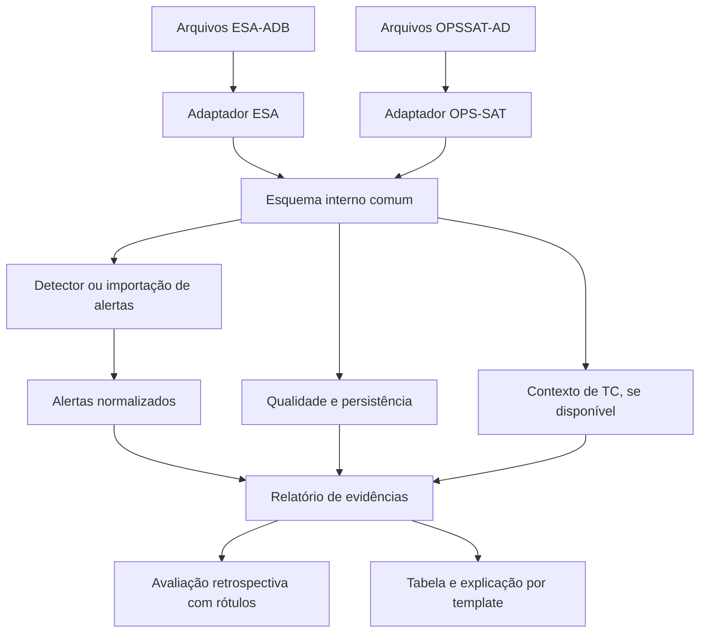

# Plano de pesquisa — Confiabilidade contextual de alertas em telemetria espacial

**Programa:** Iniciação Científica — Geração de Marte  
**Linha:** Estatística, Ciência de Dados e Inteligência Artificial  
**Duração:** 4 semanas (1 mês)  
**Situação:** proposta para discussão e aprovação do orientador, antes da execução dos experimentos  
**Data:** outubro de 2026

## 1. Título e resumo

**Título proposto:** *Avaliação contextual e reutilizável da confiabilidade de alertas em telemetria espacial: estudo com ESA-ADB e análise de portabilidade no OPSSAT-AD*.

Queremos estudar um problema que ocorre quando sistemas monitoram satélites: um comportamento incomum pode gerar um alerta, mas isso **não significa automaticamente que existe uma falha**. O alerta pode apontar uma anomalia real, um evento operacional incomum porém esperado, um problema na qualidade dos dados ou não corresponder a nenhum evento anotado.

A pesquisa vai construir uma **biblioteca em Python para reunir evidências sobre alertas**: persistência de desvios, qualidade dos dados e, quando disponíveis, telecomandos executados anteriormente. Em experimentos retrospectivos, vamos verificar se esses indicadores ajudam a identificar quais alertas estão associados a anomalias reais, a eventos nominais raros ou a períodos sem eventos anotados. A biblioteca será desenhada para receber alertas de diferentes detectores e será testada inicialmente no **ESA-ADB**. Se houver tempo e dados suficientes, testaremos a **portabilidade técnica** dos indicadores comuns para o **OPSSAT-AD**.

**A pesquisa não promete eliminar falsos alarmes, confirmar falhas, operar um satélite real nem obter uma probabilidade calibrada de confiança sem validação suficiente.** O objetivo é *medir* em que condições o contexto ajuda e em quais situações pode induzir erro.

## 2. Problema e justificativa

Satélites produzem séries temporais de telemetria: medidas de seus subsistemas ao longo do tempo. Detectores estatísticos ou de machine learning podem reconhecer comportamentos atípicos e emitir alertas. O desafio é que há operações planejadas, ruídos, lacunas e mudanças normais de regime que podem parecer anomalias.

O artigo *European Space Agency Benchmark for Anomaly Detection in Satellite Telemetry* registra **118 anomalias e 78 eventos nominais raros na Mission1**, e **31 anomalias e 613 eventos nominais raros na Mission2**. Portanto, saber apenas que ocorreu um desvio não é suficiente. A ESA-ADB também destaca a importância de reduzir falsos positivos, indicar canais envolvidos e evitar repetição de alarmes.

A base é anonimizada. Não conhecemos necessariamente a identidade física dos canais e dos telecomandos, portanto **proximidade temporal não demonstra que um TC causou uma mudança**. O artigo informa que certos TCs podem ajudar a distinguir eventos, mas que uma resposta ausente ou inesperada após TC também pode caracterizar anomalia.

**Relevância:** contribuir para um monitoramento mais auditável e para uma avaliação honesta dos limites de regras contextuais, sem depender de um detector proprietário ou de um modelo de IA específico.

## 3. Pergunta, objetivo e hipóteses

### Pergunta central

**Em que medida indicadores de qualidade dos dados, comportamento temporal e contexto de telecomandos ajudam a avaliar a confiabilidade de alertas de anomalia em telemetria espacial, sem ocultar anomalias reais, e quais desses indicadores podem ser reutilizados em outra base de dados?**

### Objetivo geral

Desenvolver e avaliar experimentalmente uma biblioteca modular, independente do detector, que produza um relatório de evidências para alertas em dados espaciais históricos, com estudo principal no ESA-ADB e estudo opcional de portabilidade no OPSSAT-AD.

### Objetivos específicos

1. Entender os formatos dos dados e dos rótulos (inclusive a diferença entre anomalia, evento nominal raro e ausência de evento).
2. Produzir um conjunto inicial de alertas com um detector estatístico simples ou importar alertas de um detector já disponível.
3. Implementar indicadores de qualidade dos dados, persistência, agrupamento de alarmes e contexto de telecomandos.
4. Avaliar quantitativamente se os indicadores ajudam a distinguir grupos de alerta, preservando os alertas originais.
5. Simular, **apenas offline**, políticas opcionais de priorização ou supressão para medir ganhos **e anomalias indevidamente ocultadas**.
6. Separar o núcleo reutilizável dos adaptadores específicos por dataset.
7. Testar a portabilidade do núcleo no OPSSAT-AD, se viável; documentar diferenças de tarefa e dados.

### Hipóteses testáveis

- **H1:** persistência e agrupamento reduzem alertas redundantes, mas podem atrasar ou perder eventos curtos.
- **H2:** evidências de TCs *anteriores* ao alerta acrescentam capacidade de distinguir eventos nominais raros de anomalias, além do score bruto; isso precisa ser demonstrado, não pressuposto.
- **H3:** indicadores independentes dos telecomandos podem ser reutilizados em outro dataset com um adaptador, embora parâmetros e avaliação precisem ser adequados à missão.

**Hipótese nula aceitável:** os indicadores não acrescentam informação relevante ou a contextualização prejudica o recall. Isso também é um resultado científico.

## 4. Conceitos essenciais

| Conceito | Significado neste projeto |
|---|---|
| Telemetria | Valores registrados em canais ao longo do tempo. |
| Canal | Uma série temporal identificada por um código. A identidade física pode ser anonimizada. |
| Telecomando (TC) | Registro de comando executado/enviado no contexto da missão, com timestamp. |
| Detecção | Um ponto ou janela que excedeu uma regra ou limite de um detector. |
| Alerta | Um agrupamento de detecções apresentado como ocorrência a investigar. |
| Anomalia anotada | Evento classificado como anômalo no conjunto de referência (*ground truth*). |
| Evento nominal raro | Comportamento incomum mas operacionalmente esperado, conforme o rótulo de referência. |
| Falso alarme | Detecção que não corresponde ao evento-alvo segundo a definição de avaliação. |
| Persistência | Exigir desvios durante certo número de amostras ou intervalo temporal. |
| Evidência contextual | Informação adicional, como um TC recente, que pode ajudar a interpretar o alerta. |
| Confiança calibrada | Probabilidade estimada cuja frequência observada de acerto corresponde ao valor previsto; **não é um score arbitrário**. |
| Portabilidade | Reaproveitar implementação e interface, adaptando entrada e parâmetros; diferente de generalização de desempenho. |

## 5. Escopo e decisões

### Núcleo obrigatório — concluir mesmo com pouco tempo

- Um subconjunto de uma missão do ESA-ADB, **com eventos e TCs suficientes** para análise.
- Um detector estatístico simples e rastreável (ou alertas pré-gerados com mesma definição de eventos).
- Indicadores: qualidade temporal, persistência e contexto de TCs.
- Comparações A/B/C e métricas de detecção/segurança.
- Biblioteca Python modular, testes automatizados e relatório de limitações.

### Extensão se o núcleo estiver pronto

- Adaptador OPSSAT-AD e indicadores comuns aplicados por segmento.
- Comparação com Isolation Forest, sem mudar a pergunta principal.
- Explicação por template determinístico.

### Fora do escopo inicial

- Treinar Autoencoders ou redes LSTM; procurar o melhor detector da literatura.
- MCP, agente ou interface conversacional; LLM e *guardrails* extensos.
- Monitoramento em tempo real ou envio de comandos a satélites.
- Supressão de alarmes em produção.
- Generalização comprovada a toda missão espacial.

**Por quê?** Em quatro semanas, cada camada extra introduz um experimento e novos riscos. Primeiro é necessário demonstrar se o contexto agrega valor real.

## 6. Dados: quais, por que e limitações

### 6.1. ESA-ADB — estudo principal

**Fonte:** [Zenodo — ESA Anomalies Dataset](https://doi.org/10.5281/zenodo.12528696); [repositório oficial ESA-ADB](https://github.com/kplabs-pl/ESA-ADB); [artigo](https://arxiv.org/abs/2406.17826).

O ESA-ADB disponibiliza telemetria de missões, rótulos por canal, tipos de evento, descrição de canais e dados de telecomandos. A Mission1 tem 76 canais (58 alvos), 698 tipos de TC; a Mission2 tem 100 canais (47 alvos), 123 tipos de TC. Os dados completos são volumosos. Não precisamos processar todos os canais no primeiro experimento.

**Atenção:** os subconjuntos leves de canais 41–46 (Mission1) e 18–28 (Mission2) foram publicados para experimentos iniciais **sem telecomandos incluídos nesses subconjuntos**. Para estudar TCs, carregar separadamente os dados correspondentes da missão completa e verificar se há comandos pertinentes nas janelas. Não presumir que todos os eventos nominais tenham TC identificável.

**Recorte recomendado:** iniciar com **Mission2 e um pequeno conjunto de canais de interesse com seus TCs** porque há muitos eventos nominais raros; antes de fixar, fazer auditoria de frequência de eventos, TCs e disponibilidade de rótulos na fração selecionada. Se o recorte não contiver anomalias suficientes para avaliar o risco de ocultá-las, ampliar canais/janelas ou trocar para Mission1. Essa é uma decisão da Fase 1, não uma garantia antecipada.

Arquivos e campos devem ser inspecionados na versão efetivamente baixada; exemplos de tabelas internas padronizadas:

- `telemetry(ts, channel, value)`;
- `telecommands(ts, tc_id, priority)`;
- `events(event_id, start, end, event_class)`;
- `event_channels(event_id, channel, start, end)`;
- `alerts(alert_id, start, end_observed, channels, detector, score, rule_id)`.

**Não confundir os exemplos de esquema com nomes exatos dos arquivos originais.**

### 6.2. OPSSAT-AD — validação de portabilidade (opcional)

**Fontes:** [artigo no Scientific Data](https://www.nature.com/articles/s41597-025-05035-3); [repositório OPS-SAT-AD](https://github.com/kplabs-pl/OPS-SAT-AD); [catálogo de dados](https://github.com/kplabs-pl/AI-datasets).

Tem **2.123 segmentos** associados a **9 canais de sensores**, com dados originais em `segments.csv` e **18 características por segmento** em `dataset.csv`, além de rótulos de anomalia. O recorte por segmentos **não é equivalente** a uma série contínua de missão e não inclui uma tabela de telecomandos equivalente na distribuição descrita no artigo. Assim:

- Podem ser reutilizados: normalização do esquema, checagens dentro de segmentos, estatísticas, relatórios e parte dos testes.
- Não podem ser repetidos sem adaptações: histórico contínuo de alertas por mês, alinhamento com TCs, divisão de eventos nominal raro versus anomalia igual ao ESA-ADB.
- Usar a **divisão de treino/teste oficial do OPSSAT-AD**; não impor a divisão temporal do ESA-ADB a essa base de segmentos.

### 6.3. Divisão e vazamento de informações

No ESA-ADB, respeitar a divisão temporal oficial: primeira metade treino, segunda metade teste; últimos 3 meses do bloco de treino para validação. Os dados de treino contêm anomalias. Ajustar baselines e parâmetros sem consultar o teste. Para cada alerta, usar apenas dados observáveis **até o instante da decisão**, salvo análises retrospectivas expressamente marcadas.

No OPSSAT-AD, manter os flags oficiais `train` e os rótulos apenas para avaliação ou para procedimentos supervisionados declarados.

## 7. Arquitetura proposta



A biblioteca trabalha **após** a detecção. O detector produz alertas; o avaliador calcula evidências, não declara que uma falha física está confirmada. Um indicador ausente recebe `status=unavailable`, nunca `false`.

### Exemplo de relatório (números fictícios)

```json
{
  "alert_id": "A001",
  "detector": "robust_threshold",
  "channels": ["CH_12"],
  "decision_time": "2002-01-01T10:05:00",
  "evidence": {
    "data_quality": {"status": "available", "gaps": 0},
    "persistence": {"status": "available", "duration_seconds": 180},
    "telecommands": {"status": "available", "count_prior_window": 1,
      "candidate_ids": ["TC_02"], "causal_relation_confirmed": false}
  },
  "interpretation": "Desvio persistente com telecomando anterior potencialmente relacionado; causa não confirmada."
}
```

**Não colocar no pacote de decisão o rótulo do teste, o fim futuro do evento ou a confirmação retrospectiva.** Eles ficam apenas no módulo de avaliação.

## 8. Método e experimentos

### 8.1. Experimento A: alertas de referência

Criar um detector estatístico simples, preferencialmente com **mediana e MAD** calibrados no treino e um limiar escolhido na validação. Tratar MAD nulo e canais categóricos separadamente. Gerar detecções e agrupá-las em alertas com regra explícita de intervalo máximo. Se optar por um detector externo, congelar sua versão e importar alertas no esquema comum. Este é o **ponto de comparação**, não a contribuição principal.

**Saída:** lista de alertas com origem, timestamp, canais, score e parâmetros; avaliação inicial usando rótulos de anomalia, nominal raro e ausência de evento.

### 8.2. Experimento B: qualidade, persistência e agrupamento

Calcular taxas de amostras ausentes, duplicação de timestamps, espaçamento irregular e duração das detecções. Aplicar diferentes persistências somente como **simulações offline** (por exemplo, 1, 3 e 5 amostras ou duração equivalente, conforme frequência real). Agrupar detecções adjacentes. Comparar redução de alarmes repetidos versus perda de eventos curtos e atraso até o primeiro aviso confirmado.

**Atenção metodológica:** qualidade de dados e persistência não são a mesma coisa. Um sensor plano pode significar problema do instrumento, sinal normal estável ou dado congelado; sem validação externa não afirmar qual.

### 8.3. Experimento C: contexto temporal de telecomandos

Para cada alerta em `t`, buscar TCs executados em uma janela **passada** `[t − Δ, t]`, nunca em `(t, t + Δ]` durante a simulação online. Experimente Δ pré-definido (por exemplo, 5, 15 e 30 minutos), escolhido na validação. Registrar TC ID, prioridade, tempo desde o TC e frequência histórica no treino.

É melhor começar com uma análise descritiva: quais TCs aparecem antes de alertas rotulados nominais? Quais também aparecem antes de anomalias reais? A prioridade 3 é uma **indicação de relevância para experimentar**, não prova de causa. Evitar escolher TCs olhando o teste. Para avaliar associação específica, usar medidas simples com n e intervalos de incerteza, sempre respeitando a anonimização.

**Saídas:** tabela de associação TC–tipo de evento, análise do valor adicional sobre score/persistência, casos em que contexto induziria interpretação errada.

### 8.4. Simulação de políticas de priorização (sem apagar alertas)

Definir, na validação, condições para etiquetar alertas como `evidencia_contextual_presente`, `evidencia_contextual_ausente`, `contexto_indisponivel` e `qualidade_dados_comprometida`. Avaliar se os grupos têm precisões diferentes. **Não atribuir probabilidade percentual de confiabilidade sem calibração adequada.**

Como estudo secundário, simular uma hipotética política de supressão por TC e medir **quantas anomalias reais seriam indevidamente ocultadas**. Nunca tratar presença de TC como prova de nominalidade; reportar explicitamente o custo da política.

### 8.5. Experimento D: portabilidade no OPSSAT-AD

Escrever `OpsSatAdapter` para transformar segmentos/atributos em objetos comuns. Rodar validações e indicadores compatíveis; deixar contexto TC como indisponível. Medir se a mesma implementação executa sem alterações no núcleo, quais parâmetros precisam de nova calibração e quais métricas permanecem válidas. Usar rótulos e split do OPSSAT-AD. **Não comparar diretamente números brutos de ESA-ADB e OPSSAT-AD como se fossem o mesmo teste.**

## 9. Métricas e critérios de interpretação

| Métrica | Responde | Cuidado |
|---|---|---|
| Precisão por evento (anomalia como positiva) | Quantos alertas correspondem a anomalias reais? | Nominais raros entram como não anomalia neste recorte. |
| Recall de anomalias | Quantas anomalias anotadas foram capturadas? | Fundamental para evitar supressão perigosa. |
| Alertas em eventos nominais raros | Quanto do ruído operacional decorre de eventos esperados? | Não confundir com alertas sem evento. |
| Alertas sem correspondência por duração nominal | Quantos alarmes aparecem fora de eventos anotados? | Usar tempo, não apenas contagem de pontos. |
| Alarming precision do ESA-ADB | O detector repete alarmes para a mesma ocorrência? | Utilizar a implementação e definição oficial. |
| Tempo até alerta | Persistência atrasou a identificação? | Respeitar `decision_time`. |
| Cobertura de contexto | Qual fração dos alertas tinha TCs avaliáveis? | Ausência de TC diferente de dado indisponível. |
| Perda simulada de anomalias | Quantas anomalias verdadeiras seriam ocultadas? | Principal métrica de segurança da política. |
| Valor incremental | Contexto diferencia eventos além do score e qualidade? | Comparar as mesmas amostras e partições. |

A avaliação do ESA-ADB usa métricas específicas (por exemplo, *corrected event-wise F0.5*, *alarming precision* e ADTQC), não apenas precision/recall calculados por amostra. Usar suas implementações oficiais quando aplicáveis. Relatar **n**, por evento e classe; intervalos de incerteza por evento/blocos, se o tamanho da amostra permitir.

**Critérios mínimos de aceitação do protótipo:** execução reprodutível; nenhum uso de dados futuros na decisão; alertas originais preservados; rótulos de teste isolados da biblioteca; indicadores ausentes explicitados; métricas de impacto positivo **e negativo** reportadas; ao menos dois casos de erro analisados. Não inventar metas de desempenho; defini-las com o orientador antes do teste.

## 10. Passo a passo detalhado — 4 semanas

### Semana 1 — Entender e preparar

**Dia 1 — Delimitar:** rever pergunta, hipóteses, selecionar E1/E2/E3 como obrigatórios, definir quem implementa cada parte, abrir repositório e escrever `research_protocol.md` com decisões e métricas.

**Dia 2 — Obter os dados:** baixar ESA-AD do Zenodo, ler README e formatos reais; listar canais, janelas, TCs, rótulos e tamanhos. Não baixar tudo sem estimar armazenamento.

**Dia 3 — Explorar:** produzir gráficos de 3 a 5 canais mostrando comportamento nominal, anomalia e evento nominal raro; inspecionar TCs que ocorrem nas proximidades desses eventos.

**Dia 4 — Auditar recorte:** contar anomalias, eventos nominais e TCs no recorte candidato, incluindo quantos eventos realmente aparecem nos canais selecionados. Escolher Mission2 ou Mission1 com base nisso, documentando a decisão.

**Dia 5 — Preparar o ambiente:** instalar bibliotecas, criar adaptador ESA e tabelas internas; preservar timestamps, checar tipos, duplicatas, faltantes, frequência e anotações; estabelecer split treino/validação/teste oficial.

**Pronto quando:** existe uma base carregável, uma tabela de disponibilidade dos campos, três gráficos rotulados e um protocolo experimental fixado.

### Semana 2 — Detector e indicadores comuns

**Dia 6 — Estatísticas do treino:** por canal, calcular mediana/MAD ou outra referência apropriada apenas no bloco de treino. Verificar canais com dispersão nula.

**Dia 7 — Detector:** gerar detecções por limiar; congelar limites na validação; registrar `rule_id`, canais, scores e timestamps.

**Dia 8 — Agrupamento:** criar identificador único por alerta, consolidando detecções adjacentes dentro de um mesmo canal ou grupo com regra documentada.

**Dia 9 — Qualidade:** implementar lacunas, duplicatas, frequência irregular e quantidade de amostras válidas na janela anterior ao alerta.

**Dia 10 — Persistência:** comparar janelas e durações com os alertas originais. Medir atrasos e perdas potenciais. Adicionar testes unitários e congelar os parâmetros.

**Pronto quando:** reproduz alertas, sabe quais regras os originaram e existe comparação A × B na validação.

### Semana 3 — Telecomandos e avaliação contextual

**Dia 11 — Preparação de TCs:** inspecionar formato original de timestamps, prioridades e IDs; garantir relógios compatíveis e alinhamento causal.

**Dia 12 — Associação temporal:** criar função que busca todos os TCs anteriores dentro da janela; não usar `merge` comum por igualdade exata, pois os registros podem ter frequências diferentes.

**Dia 13 — Análise descritiva:** comparar distribuição de TCs nos três grupos de alertas, por prioridade e antecedência, com contagens e proporções. Separar TCs frequentes de associações aparentemente específicas.

**Dia 14 — Valor incremental:** comparar alertas com apenas score/persistência versus os mesmos alertas com contexto. Usar regras simples definidas na validação; não combinar indicadores em probabilidade artificial.

**Dia 15 — Riscos e teste:** executar políticas hipotéticas de priorização/supressão offline e identificar quantos eventos anômalos seriam prejudicados. Validar no teste sem retunar decisões.

**Pronto quando:** existe tabela A × B × C, casos em que contexto ajuda e casos em que engana, sem informação de futuro.

### Semana 4 — Portabilidade, discussão e entregáveis

**Dia 16 — Generalização de interface:** refatorar estruturas `Telemetry`, `Alert`, `Context`, `EvidenceReport`; separar funções do adaptador ESA.

**Dia 17 — OPSSAT-AD, se viável:** carregar `segments.csv` e `dataset.csv`; preservar `segment`, `channel`, `timestamp`, `label` e `train`; implementar adaptador e testes.

**Dia 18 — Portabilidade:** executar indicadores compartilhados em segmentos, registrar os não aplicáveis (`telecommands: unavailable`) e separar avaliação por dataset.

**Dia 19 — Resultados:** tabelas finais, 3 gráficos principais, análise de pelo menos três casos (alerta em anomalia, nominal raro, ausência de evento/qualidade comprometida), incerteza e ameaças à validade.

**Dia 20 — Apresentação:** preparar resumo, metodologia, fluxo, resultados, limitações, documentação de reprodução e revisão com orientador.

**Se atrasar:** suspender OPSSAT-AD primeiro; depois suspender detector alternativo e explicações. **Não cortar avaliação dos riscos, split temporal, testes ou documentação.**

## 11. Organização do repositório e ferramentas

```text
space-alert-reliability/
├── README.md
├── research_protocol.md
├── requirements.txt
├── configs/
│   ├── esa.yaml
│   └── opssat.yaml
├── data/                   # dados não versionados
├── src/
│   ├── schema.py
│   ├── adapters/
│   │   ├── esa.py
│   │   └── opssat.py
│   ├── detectors/
│   │   └── robust_threshold.py
│   ├── reliability/
│   │   ├── data_quality.py
│   │   ├── persistence.py
│   │   ├── telecomand_context.py
│   │   └── report.py
│   ├── evaluation/
│   │   ├── matching.py
│   │   └── metrics.py
│   └── explain_template.py
├── tests/
│   ├── test_temporal_join.py
│   ├── test_no_future_leakage.py
│   ├── test_missing_context.py
│   ├── test_alert_grouping.py
│   └── test_dataset_adapters.py
├── notebooks/
│   ├── 01_eda_esa.ipynb
│   └── 02_results.ipynb
└── reports/
    ├── metrics.csv
    ├── cases.md
    └── final_report.md
```

**Ferramentas:** Python 3.11+, Pandas/NumPy para tratamento, DuckDB/Parquet para exploração de arquivos grandes, Matplotlib para gráficos, SciPy para estatística, Pytest para testes, Git/GitHub para versionamento. Scikit-learn apenas se executarem detector ML opcional. Não é necessário utilizar LLM, API paga, MCP nem GPU.

### Ordem de implementação das funções

```python
# Interfaces ilustrativas, não código completo
telemetry, events, tcs = EsaAdapter(config).load()
alerts = generate_statistical_alerts(telemetry, train_split, validation_split)
for alert in alerts:
    quality = assess_quality(telemetry, alert.decision_time, alert.channels)
    persistence = assess_persistence(alert, telemetry)
    context = assess_prior_commands(tcs, alert.decision_time, window_minutes=15)
    report = build_evidence_report(alert, quality, persistence, context)
    save_report(report)
# Somente no módulo de avaliação: confrontar alertas/relatórios com rótulos reservados
results = evaluate_reports(saved_reports, events, split="test")
```

O código real precisa garantir que funções de qualidade e contexto só acessem dados anteriores ao instante de decisão.

## 12. Testes de qualidade e segurança metodológica

- **Sem futuro:** adicionar um TC após o alerta não altera o contexto visto naquele instante.
- **Sem vazamento:** trocar rótulos do teste não altera alertas nem relatórios de evidências.
- **Contexto ausente:** dataset sem TCs resulta em `unavailable`, não em `false` ou `nominal`.
- **Alinhamento:** TC exatamente no limite da janela é incluído conforme convenção documentada; TC posterior não é incluído.
- **Sem duplicação:** duplicar medições idênticas não deve produzir alertas adicionais indevidos depois da política de deduplicação.
- **Persistência:** um desvio curto pode desaparecer do conjunto confirmado; o teste registra isso como possível falso negativo.
- **Agrupamento:** detecções próximas formam um evento quando a condição vale; detecções distantes não são reunidas.
- **Portabilidade:** adaptador de cada base fornece campos obrigatórios e declara capacidades opcionais.
- **Rastreabilidade:** registrar código/commit, parâmetros, versão de dados, janela, detector e momento do cálculo.

## 13. Riscos e alternativas

| Risco | Consequência | Alternativa |
|---|---|---|
| Recorte sem TCs próximos de eventos | Hipótese contextual não pode ser testada | Ampliar período/canais, analisar prioridades; se ainda inviável, documentar e concentrar em persistência/qualidade. |
| TC presente também em anomalia | Supressão perigosa | Manter alerta e medir explicitamente casos de risco. |
| Classes muito desbalanceadas | Métricas instáveis | Reportar contagens e incerteza; evitar modelo probabilístico complexo. |
| Dados de treino contaminados | Baseline enviesado | Métodos robustos e análise de sensibilidade sem consultar teste. |
| Subconjunto insuficiente | Resultados não representativos | Critério de seleção transparente e limites de generalização. |
| Limites por amostra perdem eventos longos | Avaliação otimista ou injusta | Métricas por evento oficiais. |
| OPSSAT-AD com segmentos isolados | Não reproduz monitoramento contínuo | Limitar à portabilidade de funções por segmento. |
| Escopo excessivo | Sem resultados finais | Congelar MVP e cortar extensões. |

## 14. Entregáveis e critérios de conclusão

1. Protocolo de pesquisa aprovado e com escolhas documentadas.
2. Relatório exploratório das bases e dos recortes selecionados.
3. Código de detector/replay, adaptador ESA e biblioteca de indicadores com testes.
4. Tabela comparativa dos experimentos A, B e C, com métricas e contagens de eventos.
5. Análise específica do risco de ocultar anomalias por regras de TC.
6. Três casos explicados com gráficos, canal, timestamp, contexto e rótulo retrospectivo.
7. Relatório final: hipótese, método, resultados, incertezas, limitações e trabalhos futuros.
8. **Opcional:** adaptador OPSSAT-AD e relatório de portabilidade.

**O projeto está concluído quando outra pessoa pode reproduzir os resultados, inclusive os casos em que as técnicas não melhoraram a confiabilidade.**

## 15. Como interpretar resultados possíveis

**Cenário 1:** TCs ajudam a reconhecer eventos nominais raros sem prejuízo significativo no recall — há evidência favorável ao contexto no recorte estudado; ainda não é uma garantia operacional.

**Cenário 2:** TCs coincidem com anomalias e nominais na mesma proporção — proximidade temporal isolada não fornece separação útil; propor associação específica, fases operacionais ou outros dados como futuro trabalho.

**Cenário 3:** persistência reduz alarmes mas perde eventos curtos — existe um compromisso entre carga de alarmes e sensibilidade que deve ser explicitado.

**Cenário 4:** biblioteca roda no OPS-SAT mas resultados diferem — demonstrou-se portabilidade de implementação, não generalização de eficácia.

## 16. Leituras recomendadas — ordem e perguntas de estudo

### Obrigatórias para começar

1. **Kotowski et al. — *European Space Agency Benchmark for Anomaly Detection in Satellite Telemetry*.** Ler introdução, tabelas 1–4, métodos e limitações. Pergunta: quais métricas refletem necessidades dos operadores? [Artigo](https://arxiv.org/abs/2406.17826).
2. **Repositório oficial ESA-ADB (documentação).** Conferir formato de dados, splits, limitações dos subconjuntos e avaliação oficial. [GitHub](https://github.com/kplabs-pl/ESA-ADB).
3. **Ruszczak et al. (2025) — *The OPS-SAT benchmark for detecting anomalies in satellite telemetry*.** Entender segmentos, atributos, rótulos e divisão oficial. [Artigo](https://www.nature.com/articles/s41597-025-05035-3).
4. **Repositório OPS-SAT-AD (documentação e notebook).** Entender como reproduzir um experimento na segunda base. [GitHub](https://github.com/kplabs-pl/OPS-SAT-AD).

### Complementares a localizar e conferir na biblioteca científica

5. **Parthasarathy, Afshari e Ferguson (2025) — *Satellite Fault Detection Using SPC and Time-Domain Features*.** Por que regras estatísticas e atributos temporais continuam úteis?
6. **Wu e Keogh — *Current Time Series Anomaly Detection Benchmarks are Flawed and are Creating the Illusion of Progress* (2021).** Por que alguns benchmarks superestimam desempenho? [Preprint](https://arxiv.org/abs/2009.13807).
7. **Kim et al. (2022) — *Towards a Rigorous Evaluation of Time-Series Anomaly Detection*.** Como avaliar por evento em vez de apenas por ponto?
8. **Liu, Ting e Zhou (2008) — *Isolation Forest*.** Ler somente se houver comparação de detector. [Artigo de referência](https://doi.org/10.1109/ICDM.2008.17).
9. **Cuéllar et al. (2024) — *Explainable Anomaly Detection in Spacecraft Telemetry*.** Entender a diferença entre detecção e explicação. [DOI](https://doi.org/10.1016/j.engappai.2024.108083).
10. **Kotowski et al. (2026) — *European Space Agency Dataset and Benchmark for Real-World Anomaly Detection in Spacecraft Time Series*.** Conferir a versão publicada e diferenças frente ao preprint anterior. [DMLR / OpenReview](https://openreview.net/forum?id=bbpRMoatVO).

**Nota bibliográfica:** esta é uma lista de trabalho, não uma revisão sistemática de ineditismo; conferir versões, autores e DOIs antes da referência definitiva. As leituras 1–4 e 6–10 podem ter conteúdo parcialmente sobreposto, de modo que vale registrar o que cada uma acrescenta.

## 17. Resumo executivo

Nesta IC, utilizaremos dados reais de telemetria para estudar não apenas **quando um detector dispara**, mas **que evidências tornam o alerta mais ou menos interpretável e confiável**. O núcleo será uma biblioteca estatística modular que calcula qualidade de dados, persistência e contexto de telecomandos anteriores ao alerta. Sua utilidade será medida retrospectivamente com rótulos do ESA-ADB, incluindo o risco de ocultar anomalias verdadeiras. Como extensão, investigaremos a reutilização da biblioteca no OPSSAT-AD, que não oferece os mesmos dados contextuais. Autoencoders, MCP e LLM ficam como trabalhos futuros porque não são necessários para responder à pergunta principal em quatro semanas.